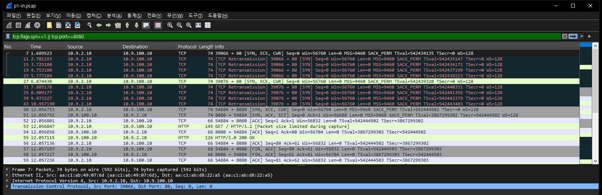
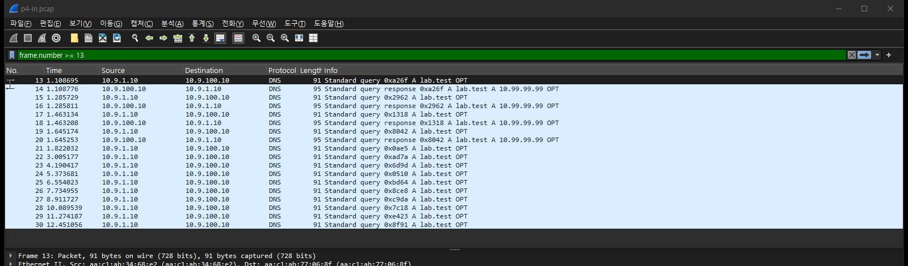

# 실험 10 — 세션 테이블 고갈 (NAT 포트 고갈)

> [실험 목록](../../README.md) · 실행 기록 [capture/run-output.txt](capture/run-output.txt)

SNAT 장비는 안쪽 연결 하나마다 바깥 (주소, 포트) 하나를 빌려 준다. 빌려 줄 포트가 다 떨어지면 무슨 일이 생기는지 본다.
포트 범위를 10개로 좁힌 NAT 노드 하나를 세우고, 연결을 쌓아 포트를 다 쓴 뒤 **기존 연결과 새 연결이 각각 어떻게 보이는지**, 그리고 **무엇이 포트를 붙잡고 있다가 언제 놓는지**(TIME_WAIT, FIN 없이 사라진 연결, UDP 질의)를 잰다. 마지막으로 범위·주소를 늘렸을 때 실제로 몇 개가 더 붙는지 잰다.

[12장](../12-acl-vs-firewall/README.md) Phase 6은 conntrack **테이블 크기**(`nf_conntrack_max`)를 낮춰 방화벽을 막았다. 이 장은 테이블은 넉넉한 채로 **NAT 포트**만 모자라게 만든다. 둘 다 "새 연결만 실패"로 보이지만 막히는 단위가 다르다.

## 장애 구성

```
   cli1 10.9.1.10~19  ─ eth1 ┐                         ┌ 캡처 nat:eth3 (NAT 뒤)
   (연결을 쌓는 쪽)          nat ── eth3 ─────────────── srv 10.9.100.10
   cli2 10.9.2.10     ─ eth2 ┘  SNAT → 10.9.100.1:20000-20009   (:80 :8080 TCP, :53 DNS)
   (나중에 온 사용자)    ↑ 캡처 nat:eth2·eth1 (NAT 앞)              기본 경로 없음
```

| 항목 | 값 |
|---|---|
| 랩 | 베이스 패브릭과 따로 뜨는 작은 랩 `natlab` (`clab-natlab-*`), 전 노드 `fwlab:1` 이미지, `network-mode: none` |
| 주입 지점 | nat 노드의 nftables `snat to 10.9.100.1:20000-20009` (TCP·UDP), 바깥 포트 10개 |
| 바꾸는 값 (nat netns 안) | SNAT 포트 범위·주소 수, `nf_conntrack_tcp_timeout_established` 432000→20, `nf_conntrack_udp_timeout` 30→5 |
| 부하 | `tools/hog.py`: 연결 N개를 동시에 열어 붙잡고 1~2초마다 PING/PONG. 최대 150개, 대역폭은 무시할 만함 |
| 관찰 | cli2의 curl (`-m 5`, 연결 시간), dig, nat의 `conntrack -L`·`conntrack -S`, NAT 앞뒤 캡처 |

srv에는 기본 경로가 없다. 안쪽 주소로 답할 길이 없으니 NAT를 거치지 않으면 연결이 안 된다(Phase 0에서 확인).
관리망을 붙이지 않는 이유는 12장과 같다. 붙이면 도커가 컨테이너마다 DNS용 NAT 규칙을 깔아 cli·srv에도 conntrack이 켜진다.
WSL 호스트 값은 건드리지 않는다. conntrack 타임아웃 sysctl은 netns마다 따로라 nat 컨테이너 안에서 바꿨다(실측: 쓰기 가능).

## 실행

WSL root:

```bash
bash /mnt/c/Users/wsm02/Desktop/Claude/clos-fabric/experiments/_wip/10-session-table-exhaustion/sync.sh   # 윈도우 원본 → /root/labs 사본
cd /root/labs/clos-fabric/experiments/_wip/10-session-table-exhaustion
containerlab deploy -t topology.yml
nice -n 10 ./run.sh all          # Phase 0~5, 약 3분 → capture/run-output.txt   (한 단계만: ./run.sh 3)
containerlab destroy -t topology.yml --cleanup
bash /mnt/c/.../10-session-table-exhaustion/sync.sh back   # capture/ 를 윈도우로
```

`fwlab:1` 이미지가 없으면 [12장 image/](../12-acl-vs-firewall/image/)의 `build.sh`로 만든다. 중간에 멈추면 `./restore.sh`.

## 예측 (실행 전에 적음)

1. 포트 10개짜리 SNAT에 연결 20개를 동시에 걸면 정확히 10개(기존 사용자 1개를 먼저 붙여 두면 9개)만 붙는다.
2. 그 상태에서 기존 연결은 계속 PONG을 받고, 새 연결만 SYN 재전송(0·1·3초)을 하다 curl `-m 5`에서 끝난다. 실패는 `conntrack -S`의 `insert_failed`·`drop`에 SYN 하나당 1씩 쌓인다. NAT 뒤(eth3)에는 SYN이 하나도 안 나간다.
3. 같은 서버의 다른 포트(:8080)도 실패한다 — "포트 10개를 다 썼으니까".
4. 30초 기다리는 curl을 걸어 두고 5초 뒤 붙잡은 연결을 FIN으로 닫으면, 닫힌 연결이 TIME_WAIT(120초)로 남아 포트를 붙잡으므로 curl은 30초 안에 못 붙는다.
5. TIME_WAIT 10개가 남아 있는 동안 새 연결은 실패한다(최대 120초).
6. 클라이언트가 FIN 없이 사라지면 ESTABLISHED 엔트리가 5일(432000초) 남는다. 타임아웃을 지금 낮춰도 이미 있는 엔트리는 그대로다(만료 시각은 마지막 패킷 때 정해지므로). `conntrack -D`로 지우면 그 자리 하나가 바로 풀린다.
7. UDP(DNS) 질의 20개를 연달아 보내면 앞 10개만 성공하고, 이후 약 30초(udp 타임아웃) 동안 다른 사용자의 DNS도 실패한다. 타임아웃을 5초로 줄이면 5초 안팎에 풀린다.
8. 포트 100개로 넓히면 150개 중 100개, 주소 3개×포트 10개면 40개 중 30개가 붙는다.

> 3번은 본 실행 전 동작 확인(스모크 테스트) 때 이미 :8080이 붙는 걸 봤다. 그래도 처음 적은 대로 남긴다.

## 숫자

| Phase | 조건 | 결과 |
|---|---|---|
| 0 기준 | 포트 범위 제한 없음, 연결 50개 | 50/50, 새 curl 0.1ms. NAT가 원래 출발 포트를 그대로 씀(54143→54143) |
| 1 포트 10개 | 기존 사용자 1개 + cli1 20개 동시 | **9/20** 붙음, 바깥 포트 20000~20009 전부 사용 |
| | 그 상태의 새 curl (cli2 → :80) | 2회 모두 **실패, 5.0초**. SYN 5개(1초 간격), NAT 뒤로 0개 |
| | 같은 상태, cli2 → **:8080** | **성공 0.1ms** (예측 3 틀림) |
| | 기존 연결 (cli2 1개, cli1 9개) | alive 1/1, 9/9 — 끊긴 것 없음 |
| | `insert_failed`·`drop` | curl 2회 동안 **+10** (SYN 10개) |
| | 기다리는 curl, 5초 뒤 cli1이 FIN으로 닫음 | **connect 5.10초에 성공** (예측 4 틀림) |
| 2 TIME_WAIT | 클라가 먼저 닫아 TIME_WAIT×10 (117초 남음) | 새 curl 3/3 **즉시 성공**, `insert_failed` +0 (예측 5 틀림) |
| | 서버가 먼저 닫은 경우 (TIME_WAIT×6) | 3/3 즉시 성공 |
| 3 FIN 없이 사라짐 | ESTABLISHED×10, 431997초 남음 | 새 curl 실패 |
| | 지금 timeout 432000→20 | 28초 뒤에도 431968초 남음, **여전히 실패** |
| | `conntrack -D --reply-port-dst 20000` | 지운 직후 새 curl 성공 |
| | 처음부터 timeout 20초 | 사라진 뒤 **20.2초**에 첫 성공 |
| 4 UDP 30초 | DNS 질의 20개 연달아 | **10/20** (`oooooooooo` 뒤 전부 `x`), `insert_failed` +10 |
| | 다른 사용자(cli2) DNS | 첫 질의 기준 **30.5초**에 첫 성공 (그 전 12번 실패) |
| 4 UDP 5초 | 같은 20개 | **17/20** (`ooooooooooxxxooooooo`), 3개만 실패 |
| | cli2 DNS | 7.8초에 첫 시도 성공 |
| 5 고치기 | 주소 1 × 포트 10, 출발지 1, 시도 20 | 10 |
| | 주소 1 × 포트 100, 출발지 10, 시도 150 | **100** |
| | 주소 3 × 포트 10, **출발지 1**, 시도 40 | **10** (전부 .3) — 예측 30 |
| | 주소 3 × 포트 10, 출발지 10, 시도 40 | **28** (.1×10 .2×8 .3×10) — 예측 30 |

맞은 예측은 1·2(재전송 간격 빼고)·6·7·8의 단일 주소 부분이다. 틀린 것이 이 장의 결과다.

## 패킷 흐름 ① NAT 앞에서만 보이는 SYN

nat:eth2(cli2 쪽, NAT 앞) 캡처에서 SYN만 걸렀다.



- curl 하나마다 SYN이 **1초 간격으로 다섯 번** 나간다(7·11·15·19·23번). 예측한 0·1·3초 지수 백오프가 아니다. cli2의 `tcp_syn_linear_timeouts = 4`(커널 6.5에 생긴 값, 처음 4번 재전송은 1초 간격) 때문이다. SYN-ACK도 RST도 오지 않으니 클라이언트가 볼 수 있는 건 "응답 없음"뿐이다.
- 같은 시간 nat:eth3(NAT 뒤)에는 이 SYN이 **하나도** 없다. NAT 뒤 캡처(`p1-out.pcap`) 4개는 :8080 SYN/SYN-ACK와 마지막에 붙은 :80 SYN/SYN-ACK뿐이다. 서버 쪽에서는 아무 일도 없었던 것처럼 보인다.
- 50번부터 :8080은 SYN 한 번에 붙는다. 바깥 포트는 `20001`, :80 쪽이 다 쓴 그 포트 중 하나다.
- 기다리던 curl은 SYN을 1초 간격으로 다시 보내다가, cli1이 연결을 닫은 직후의 SYN(첫 SYN 뒤 5.1초)에 붙었다. TIME_WAIT가 남아 있었는데도 그렇다(Phase 2).

## 패킷 흐름 ② DNS: 10개 성공 뒤로는 질의만 있다

nat:eth1(cli1 쪽, NAT 앞)에서 본 DNS 질의 20개의 뒷부분.



- 20번까지(질의 10개)는 질의·응답이 짝지어 0.2초 간격으로 지나간다.
- 21번부터는 질의만 있다. dig가 1초 기다렸다 포기하고 다음 질의를 보내니 간격이 약 1.2초다. NAT 뒤(`p4-out.pcap`)에는 정확히 질의 10개·응답 10개, 20패킷뿐이다.
- 성공한 질의의 엔트리는 응답을 받고 나서도 `udp` 타임아웃(30초) 동안 남아 바깥 포트를 쥐고 있다. 그래서 cli2의 질의도 30.5초 동안 막혔다. 다른 사용자, 다른 출발 주소인데도 목적지(srv:53)가 같으면 같은 포트 10개를 나눠 쓰기 때문이다.

## 결론

SNAT 포트를 10개로 좁히고 연결을 쌓았다. 10개가 차는 순간부터 **새 연결만** 실패했다. 이미 붙어 있던 10개(다른 사용자 연결 포함)는 PING/PONG을 한 번도 놓치지 않았다. 새 연결은 클라이언트 쪽에서 SYN을 1초 간격으로 다섯 번 보내다 끝났고, 그 SYN은 NAT 뒤로 하나도 나가지 않았다. 서버 로그·서버 쪽 캡처에는 흔적이 없고, NAT 장비 안에서도 남는 건 `conntrack -S`의 `insert_failed`·`drop` 카운터(SYN 하나당 1)뿐이었다. 실패한 연결은 `conntrack -L`에 엔트리로도 남지 않는다. 12장의 테이블 한도 초과는 dmesg에 `table full` 한 줄이라도 남겼는데, 이번엔 dmesg를 따로 보지 않았으니 그쪽 흔적 여부는 모른다.

포트가 모자란 단위는 "NAT 장비 전체"가 아니라 **(바깥 주소, 목적지 주소, 목적지 포트)** 조합이었다. 같은 서버의 :80이 꽉 찬 상태에서 :8080은 바로 붙었다. 그래서 이 장애는 "특정 서버(예: 하나뿐인 API 게이트웨이, DNS 리졸버)로 가는 새 연결만 가끔 안 된다"로 보이기 쉽다. 무엇이 포트를 쥐고 있는지도 예측과 달랐다. 커널 6.6의 NAT는 TIME_WAIT 엔트리가 쥔 포트를 새 SYN에 바로 내줬다(TIME_WAIT 10개가 117초 남은 채 새 curl 3/3 성공). 진짜로 오래 쥐는 것은 **FIN 없이 사라진 연결**(ESTABLISHED 기본 432000초=5일)과 **끝난 UDP 질의**(30초)였다. 타임아웃을 나중에 낮추면 이미 있는 엔트리는 그대로라(28초 뒤에도 431968초 남음) 그 자리에서는 `conntrack -D`로 지울 수밖에 없었고, 처음부터 20초로 두면 20.2초에 풀렸다. UDP 타임아웃을 5초로 줄이자 같은 폭주에서 실패가 10개에서 3개로 줄었다.

고치기도 곱셈대로 되지 않았다. 포트 100개는 정확히 100개를 받았지만, 주소를 3개로 늘린 규칙은 안쪽 주소 하나에서 오는 40개 중 10개만 붙였다. 안쪽 주소마다 바깥 주소가 하나로 고정돼 있었다(주소별 매핑을 찍어 보니 10.9.1.10→.3, .12→.1, .13→.2 …). 리눅스 NAT는 바깥 주소를 (안쪽 주소, 목적지)의 해시로 하나 고르고 그 주소의 포트만 뒤지는데, 측정이 그 동작과 맞는다. 그래서 안쪽 주소가 하나면 주소를 몇 개 더해도 소용없고, 안쪽 주소가 10개여도 해시가 고르지 않아(.1에 3개, .2에 2개, .3에 5개) 30이 아닌 28이었다. 다음에 "어떤 목적지로만 새 연결이 가끔 타임아웃, 기존 연결은 멀쩡"이라는 증상을 만나면, NAT 장비의 `conntrack -S`에서 `insert_failed`가 오르는지 먼저 보고, `conntrack -L`을 목적지별로 세어 그 목적지의 엔트리 수가 포트 범위에 닿았는지, 그 엔트리가 어떤 상태(ESTABLISHED인데 오래 조용한 것, UDP)인지 본다.

## 한계

- 리눅스 nftables SNAT 하나만 봤다. 상용 방화벽·클라우드 NAT 게이트웨이는 포트 할당(블록 할당, 주소 고르기, TIME_WAIT 재사용, 타임아웃)이 다르다. TIME_WAIT 재사용은 이 커널(6.6.114 WSL2)에서 잰 결과이고, 커널 소스에서 그 코드 경로를 확인하지는 않았다.
- 포트 10~100개로 축소해 재현했다. 실제 고갈(주소당 약 64,000개)에서의 해시 탐색 비용·CPU는 재지 않았다.
- 바깥 주소 3개 규칙에서 분배가 고르지 않은 건 안쪽 주소 10개, 한 번의 배치로 본 것이다. `persistent`·`random` 플래그는 시험하지 않았다.
- 클라이언트 쪽 증상은 리눅스 클라이언트(`tcp_syn_linear_timeouts=4`)의 것이다. 다른 OS는 SYN 재전송 간격이 다르다.
- Phase 1의 `insert_failed` 증가를 "SYN 하나당 1"로 맞춘 건 curl 2회(SYN 10개, +10) 한 구간이다. 전체 누적값(48)에는 cli1의 실패한 연결 시도가 섞여 있다.
- 첫 전체 실행은 WSL 재시작으로 랩이 사라져 버렸고, 같은 스크립트로 다시 돌린 결과를 실었다. 스모크 테스트 때의 숫자(9/20, 10/20, 28/40, 30초대 회복, 20초대 회복)와 같았다.

## 파일

| 파일 | 내용 |
|---|---|
| `topology.yml` | 랩 `natlab` (cli1·cli2·nat·srv) |
| `run.sh` | Phase 0~5: SNAT 규칙 주입 → 캡처 → 연결·질의 → 원복. `./run.sh all`이면 `capture/run-output.txt` |
| `restore.sh` | 중간에 멈췄을 때 원복 (nat 규칙·타임아웃·보조 주소, cli1 차단 규칙) |
| `sync.sh` | 윈도우 원본 → `/root/labs` 사본 (CRLF 제거), `back`이면 capture/ 를 되가져옴 |
| `tools/hog.py` | 연결 N개를 동시에 열고 붙잡는 클라이언트 (PING/PONG으로 생존 확인) |
| `tools/srv.py` | srv의 :80·:8080 서버 (GET이면 응답 후 닫기, PING이면 PONG) |
| `capture/p1-in.pcap`, `p1-out.pcap` | Phase 1, NAT 앞(nat:eth2)·뒤(nat:eth3). 패킷당 128바이트 |
| `capture/p4-in.pcap`, `p4-out.pcap` | Phase 4 DNS 질의 20개, NAT 앞(nat:eth1)·뒤(nat:eth3) |
| `img/` | Wireshark 화면 (`_tools/ws-shot.ps1`) |
