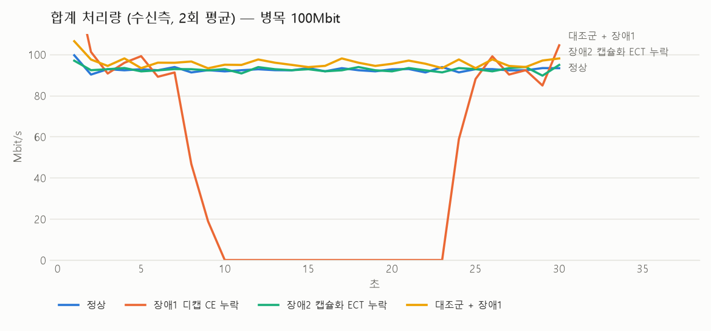
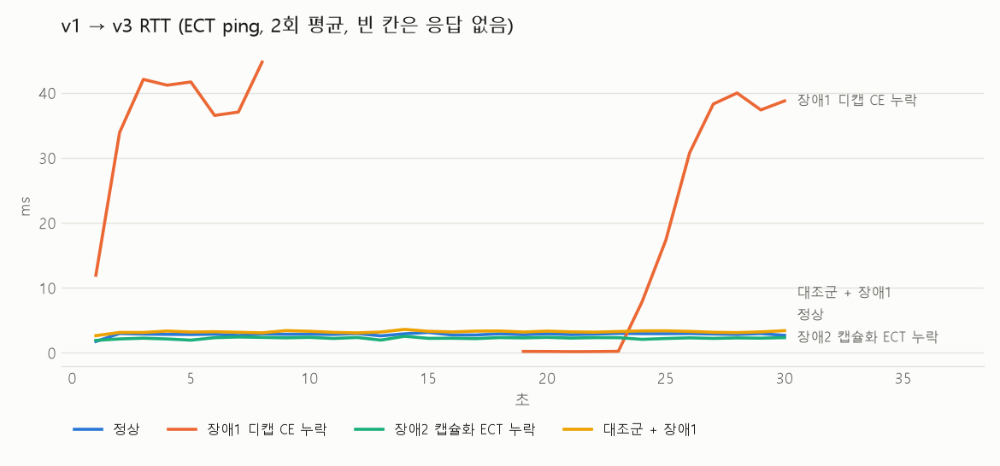
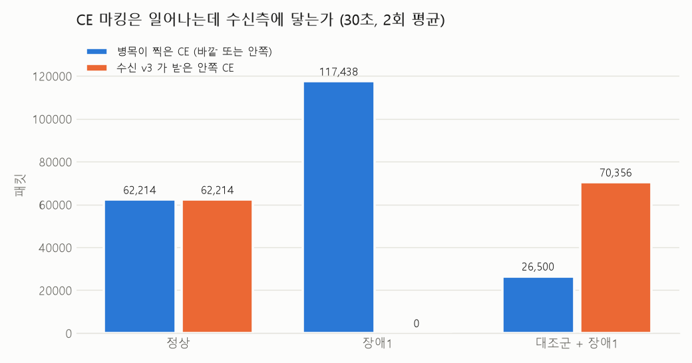
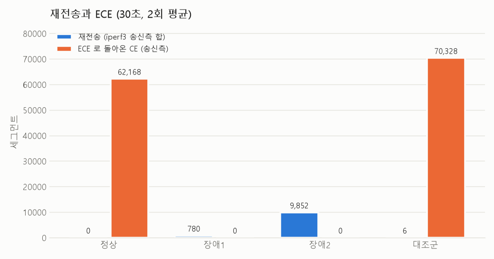

# 실험 14 — RoCE over VXLAN: ECN 전달 누락

> [실험 목록](../../README.md) · 스크립트 [scripts/](scripts/) · 지표 [data/](data/) · 그래프 [figures/](figures/)

스파인이 바깥 헤더에 CE를 찍어도, VTEP이 그것을 안쪽 헤더로 옮기지 않으면 혼잡 제어 고리가 끊긴다. 이 장은 그 이음새를 패킷과 카운터로 확인한다.

> **1회차(이 문서 본문)는 짧은 측정이다 (30초 × 2회, 노트북).** handoff 기준(60초 × 3회)은 데스크톱에서 다른 구성으로 다시 쟀다 → [2회차 상세 노트 run2/](run2/README.md), 요약은 아래 [2회차](#2회차--데스크톱-60초--3회).

## 예측 (실험 전에 먼저 작성)

Q1 신호 전달
- 리눅스 vxlan은 디캡 때 `IP_ECN_decapsulate`를 부르므로, 바깥 CE + 안쪽 ECT면 안쪽을 CE로 바꿀 것이다. 기본값에서 이미 옮겨진다.
- 캡슐화 때는 `ip_tunnel_ecn_encap`가 안쪽 ECN을 바깥으로 복사하므로 `tos` 옵션(기본 0, inherit, 고정값)과 상관없이 ECT가 바깥에 실릴 것이다. `tos` 옵션은 DSCP만 바꾼다.
- 그래서 장애 1·2는 리눅스 기본 동작에서는 일어나지 않고, tc pedit로 인위적으로 만들어야 한다. 실제로는 ECN을 옮기지 않는 하드웨어 VTEP이나 설정 실수에서 생기는 장애다.

Q2 장애 영향 (트랙 B, DCTCP 3:1 인캐스트, 병목 100Mbit)
- 정상: 스파인 RED가 마킹하고, 수신측 CE와 송신측 ECE가 같은 흐름으로 늘어난다. 드랍 0, 큐 지연은 마킹 임계값 근처(수 ms)에 머문다.
- 장애 1 (디캡 시 CE 누락): 스파인 마킹 수는 정상과 비슷하거나 더 많지만 수신측 CE와 ECE는 0. 송신측이 줄이지 않아 큐가 한도까지 찬다. 드랍과 재전송이 생기고 RTT가 수십 ms로 늘어난다. 처리량은 TCP가 손실로 다시 줄이므로 붕괴까지는 아니고 비슷할 것이다.
- 장애 2 (캡슐화 시 ECT 누락): 스파인 마킹 0, 대신 RED가 드랍한다. 손실 기반으로 떨어져 재전송이 늘고, 처리량은 약간 줄고 흔들릴 것이다.
- 대조군 (병목을 디캡 뒤로): 장애 1을 걸어도 정상과 같을 것이다.

트랙 A (rxe)
- rxe는 CNP를 만들지 않고 CE에 반응하지 않으므로, ECT로 보내도 CNP는 0이고 송신 속도도 그대로일 것이다.

## Step 0 점검 결과

| 항목 | 결과 |
|---|---|
| 패브릭 | 스파인 2 + 리프 4, eBGP 언더레이 + VNI 10010. 시작 전 BGP·EVPN·v1↔v3·h1↔h3 정상 |
| VNI 안 서버 | 원래는 v1(leaf1)·v3(leaf3) 둘뿐. 인캐스트를 위해 x2(leaf2)·x4(leaf4)를 setup.sh가 붙인다 |
| rxe 위치 | 11번의 g1~g4는 순수 L3(VNI 밖). 이 장은 e1(leaf1)·e3(leaf3)를 VNI 안에 새로 붙였다 |
| 커널 | 6.6.87.2-microsoft-standard-WSL2, rdma_rxe·crc32_generic 직접 빌드한 모듈 |
| dctcp·red·htb·pedit·csum·flower | 모두 모듈로 있음 |
| MTU | vxlan 장치 1500, 서버 9500 → 큰 프레임이 브리지에서 버려지는 09번의 함정. 서버를 1500으로 맞췄다. 언더레이 9500이라 바깥 1550은 지나간다. RoCE MTU 1024 |

**rxe는 DCQCN을 구현하지 않는다 → 트랙 B(TCP + DCTCP)를 메인으로.** 근거 두 가지:

1. 소스. `drivers/infiniband/sw/rxe/`에서 cnp·ecn·dcqcn이 나오는 곳은 `rxe_hdr.h`의 BTH FECN/BECN 비트 도우미뿐이고, 그 도우미를 부르는 `.c` 파일이 없다. 송신 IP TOS는 GRH traffic class를 그대로 쓴다(`rxe_net.c`). ECN을 읽거나 CNP를 만드는 코드가 없다.
2. 패킷 (`scripts/rxe-track.sh`, [data/rxe-track.csv](data/rxe-track.csv)). e1 → e3 ib_write_bw를 `--tclass=2`(ECT(0))로 5초 보냈다.

| tclass | 처리량 | 스파인 마킹 | 바깥 CE (leaf3 앞) | 안쪽 CE (e3 앞) | CNP | NAK |
|---|---|---|---|---|---|---|
| 2 (ECT0) | 82.7 Mbit/s | 42,961 | 42,961 | 42,961 | **0** | 0 |
| 0 (Not-ECT) | 측정 실패 | — | — | — | — | — |

보낸 데이터 43,927개 중 42,961개(98%)가 CE를 달고 e3까지 갔다. VXLAN이 CE를 안쪽으로 잘 옮겼는데도 e3는 CNP를 한 번도 보내지 않았고, e1은 속도를 줄이지 않아 큐가 계속 임계값 위에 머물렀다. 카운터는 e1 `completer_retry_err` 22, e3 `duplicate_request` 2,731 ([data/rxe-counters.txt](data/rxe-counters.txt)).
tclass 0 회차는 perftest가 연결을 못 맺어 값이 없다. 그래서 병목 손실 때의 NAK/Go-Back-N 양상은 이번에 보지 못했다(11번 R4에 손실 1%의 Go-Back-N 기록이 있다).

## 시나리오 / 주입 방법

```
 v1 (leaf1) ─┐                                      ┌─ v3 (leaf3)  수신, iperf3 서버 3개
 x2 (leaf2) ─┼─ VXLAN ─ spine1 ──[eth3 병목]── leaf3 ┤
 x4 (leaf4) ─┘          (spine2 eth3 down)          └─ eth4 (대조군 병목 자리)
```

- 트래픽: v1·x2·x4 → v3 iperf3 3흐름 동시, DCTCP. 송수신 모두 `tcp_ecn=1`, `tcp_congestion_control=dctcp`
- 병목: spine1 eth3(→ leaf3) egress에 htb 100Mbit + `red min 30KB max 45KB probability 1.0 limit 600KB ecn`. 마킹이 바깥 헤더에 일어나는 자리다
- 경로 고정: ECMP로 두 스파인에 흩어지면 병목이 둘이 되므로 spine2 eth3를 내려 leaf3 로 가는 길을 spine1 하나로 묶었다 (teardown에서 올린다)
- 장애 1 `inject-decap.sh on`: leaf3 업링크 ingress에서 바깥 IP ECN이 CE(11)인 VXLAN 패킷을 ECT(0)(10)으로 되돌린다. `tc flower ... ip_tos 0x03/0x03 action pedit ex munge ip tos set 0x02 retain 0x03 pipe action csum ip`. DSCP는 그대로
- 장애 2 `inject-encap.sh on`: 송신 리프 3대 업링크 egress에서 바깥 ECN 2비트를 00으로 지운다
- 대조군 `control.sh on`: 스파인 병목을 걷고 같은 큐를 leaf3 eth4(→ v3, 디캡 뒤 안쪽 헤더 구간)에 건다
- 측정 `measure.sh`: 1초마다 병목 tc 카운터(JSON), v3 `/proc/net/netstat`의 InCEPkts, 송신측 TCPDeliveredCE·RetransSegs, iperf3(수신측 처리량, 송신측 재전송), v1 → v3 ECT ping(`-Q 2`) RTT

## 증상

30초 × 2회 평균. 원본 [data/summary.csv](data/summary.csv), 1초 시계열 `data/<조건>-r<N>.csv`.

| | 정상 | 장애 1 디캡 CE 누락 | 장애 2 캡슐화 ECT 누락 | 대조군 + 장애 1 |
|---|---|---|---|---|
| 합계 처리량 (Mbit/s) | 92.7 | **46.3** (−50%) | 92.7 | 95.9 |
| 가장 느린 송신 (Mbit/s) | 30.8 | **5.5** | 30.1 | 31.1 |
| 병목 마킹 | 62,215 | **117,439** | 0 | 26,500 |
| 병목 드랍 | 9 | 768 | **9,867** | 1 |
| 수신측 안쪽 CE | 62,215 | **0** | 0 | 70,356 |
| 송신측 ECE (TCPDeliveredCE) | 62,169 | **0** | 0 | 70,328 |
| 재전송 | 0 | 780 | **9,852** | 6 |
| RTT 평균 / p99 (ms) | 2.7 / 3.3 | **24.6 / 47.4** | 2.1 / 2.9 | 3.0 / 4.2 |
| ping 무응답 (회 / 약 150) | 0 | **51** | 7 | 0 |
| 장애 필터에 걸린 패킷 | — | 116,724 | (리프 3대 egress, 이번 회차 미집계) | 0 |






장애 1에서 각 장비 카운터만 따로 보면 모두 멀쩡해 보인다. 스파인은 마킹을 정상보다 두 배 가까이 했고(혼잡을 잘 알리고 있음), leaf3는 디캡 오류를 하나도 내지 않았고, 수신 서버는 손실 없이 ECT 패킷을 받았다. 고리가 끊긴 것은 스파인 마킹 117,439와 수신측 CE 0을 나란히 놓아야 보인다.

## 추적 과정

**예측이 틀린 곳: 장애 1의 처리량.** 비슷할 거라 봤는데 절반으로 떨어졌다. 1초 시계열과 송신측 iperf3의 cwnd를 보면 이유가 보인다 (fault-decap r1).

| 초 | 합계 Mbit/s | 병목 큐 | RTT | 송신 3대 cwnd |
|---|---|---|---|---|
| 4~7 | 82~101 | 350~480KB | 32~42 ms | 75 → 130 세그먼트로 계속 커짐 |
| 8 | 0 | 100KB → 0 | 47.6 ms | 세 흐름이 **같은 순간 1로** (RTO) |
| 9~16 | 0 | 0 | 응답 없음 | 1 |
| 17~23 | 0 | 0 | 0.14~0.21 ms | 1 (재전송 타이머 대기) |
| 24~ | 87~93 | 다시 300~400KB | 15 → 40 ms | v1·x4 복구, x2는 두 회차 모두 30초 끝까지 복구 못 함 |

ECE가 오지 않으니 DCTCP는 cwnd를 계속 키우고, 큐가 한도(600KB, 약 48ms)에 닿자 꼬리 드랍이 세 흐름을 동시에 덮쳐 모두 재전송 타이머로 떨어졌다. 그다음 약 15초는 큐가 텅 빈 채 아무도 보내지 않는다. 0.2 → 0.4 → … → 6.4초로 늘어나는 타이머 백오프 합(약 12.6초)과 길이가 비슷하다. 두 회차 모두 같은 모양이었다.

**설명 못 한 것: 9~16초의 ping 무응답.** (→ 2회차에서 밝힘: 스파인의 BGP keepalive 가 ECN RED 에 버려져 spine1–leaf3 세션이 끊긴 구간. [아래 2회차](#2회차--데스크톱-60초--3회)) 큐가 비었는데도 ECT ping이 약 8초 동안 돌아오지 않았고, 이 구간의 TCP 재전송도 실패했다(병목 드랍이 초당 1~3개 남아 있음). RED의 평균 큐 길이가 실제 큐가 빈 뒤에도 최대 임계값 위에 남아 Not-ECT 재전송을 버렸을 가능성을 의심하지만, ping은 ECT라 그것만으로는 설명이 안 된다. 원인은 확정하지 못했다.

틀린 길과 측정 함정 (시간 순):
1. **DCTCP 협상 실패.** 첫 시험에서 v3가 받은 데이터가 거의 전부 Not-ECT였다. `ss -ti`로 보니 송신 소켓이 `dctcp-reno`. 리눅스 DCTCP는 SYN에도 ECT를 싣는데, cubic인 수신측은 ECT가 붙은 SYN을 보면(RFC 3168: SYN은 Not-ECT) ECN 협상을 거절한다. 수신측도 DCTCP로 바꾸자 정상이 됐다. 컨테이너 netns에서 dctcp를 고르려면 기본 netns의 `tcp_allowed_congestion_control`에 dctcp가 있어야 한다(없으면 EPERM)
2. **veth GSO.** veth가 64KB 덩어리를 그대로 넘겨 RED가 덩어리 단위로 마킹한다. 서버 eth1의 tso/gso/gro를 껐다. WSL에는 ethtool이 없어 서버(alpine) 안의 것을 `docker exec --privileged`로 썼다
3. **처리량 기준.** 장애 2 시험에서 송신측 iperf3가 100Mbit 병목보다 큰 102Mbit/s를 냈다. 앱이 소켓에 쓴 양이라서다. 수신측(`--get-server-output`) 값으로 바꿨다
4. **tcpdump 줄 수.** VXLAN 패킷은 바깥·안쪽 두 줄로 찍혀 처음 집계가 정확히 두 배였다. 시각으로 시작하는 줄만 센다
5. **표본 시각 밀림.** 1초 표본이 표본 뜨는 시간만큼 뒤로 밀려, 처음 그린 시계열에서는 큐가 꽉 찬 시점과 처리량 0인 시점이 겹쳐 보였다. iperf 시작 시각 기준으로 보간해 다시 집계했다
6. **rxe가 커널을 멈춤.** 처음 붙인 rxe는 VRF 장치(MTU 65536)를 보고 RoCE MTU를 4096으로 잡았다. 1500짜리 VNI를 못 지나가 재전송이 끝없이 돌다 `soft lockup - CPU#0 stuck for 26s! [ib_write_bw]`로 WSL이 멈췄다. VRF 장치 MTU를 1500으로 묶어 1024가 되게 했고, 본 측정과 떼어 맨 끝에 돌린다
7. **실행 겹침.** 첫 본 측정을 멈춘 줄 알았는데 kill이 안 맞아 두 벌이 동시에 돌았다. 그 데이터는 버렸다

Q1 결과 ([data/q1-signal.csv](data/q1-signal.csv), 8초씩, 캡처 앞 200개는 `data/pcap/`):

| 변형 | 캡슐화 직후 바깥 (leaf1) | 디캡 직전 바깥 CE (leaf3) | 디캡 뒤 안쪽 CE (v3 앞) | 스파인 마킹 |
|---|---|---|---|---|
| 기본 (tos 0) | ECT0 100%, tos 0x02 | 16,677 | 16,670 | 16,677 |
| tos inherit | ECT0 100%, tos 0x02 | 16,706 | 16,693 | 16,706 |
| tos 0x20 | ECT0 100%, tos 0x22 | 16,589 | 16,585 | 16,589 |
| 장애 1 | ECT0 100% | 67,736 | **0** | 68,168 |
| 장애 2 | **Not-ECT 100%** | 0 | 0 | 0 |

리눅스 vxlan은 기본값에서 CE를 안쪽으로 옮기고(차이 4~13개는 캡처 시작·끝 경계), 캡슐화 때 ECT를 바깥으로 복사한다. `tos` 옵션은 DSCP만 바꾸고 ECN 2비트는 늘 안쪽을 따른다. **장애 1·2는 리눅스 기본 동작에서 일어나지 않으며, 여기서는 tc pedit로 인위적으로 재현했다.**

## 원인 / 복구

- 원인(재현): 디캡 지점에서 바깥 CE가 안쪽으로 옮겨지지 않으면, 수신측은 혼잡을 모르고 ECE를 돌려주지 않는다. DCTCP 송신은 손실이 날 때까지 창을 키운다. ECN 마킹 임계값(30~45KB)이 아니라 큐 한도(600KB)에서 꼬리 드랍이 나고, 그 드랍이 모든 흐름을 동시에 타이머로 보낸다
- 복구: 필터를 걷으면(`inject-decap.sh off`) 즉시 정상 마킹·ECE로 돌아온다. 실제 장비라면 VTEP의 ECN 디캡 모드(RFC 6040 normal/compatibility)를 확인하는 것이 첫 순서다
- Step 6 정리 후 확인 ([data/teardown.txt](data/teardown.txt)): leaf1·leaf3 BGP 세션 4개(스파인 2 × IPv4·EVPN) Established, EVPN 경로 있음, leaf1 → leaf3 VTEP 경로 2갈래(ECMP 복구), v1 → v3·h1 → h3 손실 0%, 바꾼 인터페이스 qdisc 모두 noqueue

## 대조군 결과

병목을 디캡 뒤(leaf3 → v3)로 옮기면 마킹이 안쪽 헤더에 바로 찍힌다. 같은 장애 1 필터를 걸어도 바깥 헤더에는 CE가 없으므로 필터에 걸린 패킷이 0이고, 처리량 95.9 / 96.1, 재전송 6 / 7, RTT 3.0 / 3.0ms로 장애 유무가 차이를 내지 않았다. 문제는 장비가 아니라 캡슐화 이음새에 있다.

대조군에서 병목 마킹(26,500)보다 수신측 CE(70,356)가 많은 것은, 디캡 뒤에서는 vxlan GRO로 여러 패킷이 한 skb로 묶여 큐에 들어오고 RED가 그 skb 하나를 마킹하면 수신측에서는 여러 패킷이 CE로 보이기 때문으로 본다(스파인 병목에서는 마킹 수와 CE 수가 정확히 같았다).

## 2회차 — 데스크톱, 60초 × 3회

[run2/](run2/README.md). 서버를 rxe 가 붙는 VRF(g1·g2·g4 → g3)로, 병목을 300Mbit 로 바꿔 같은 질문을 다시 쟀다. 세 트랙 모두 60초 × 3회: 트랙 B(TCP+DCTCP), 트랙 A′(rxe + 실험 13 의 흉내 DCQCN), 트랙 A(rxe 그대로 — 장애1 은 차이 없음, 장애2 −84% 와 go-back-N NAK 2.6배).

| TCP + DCTCP, 3회 평균 | 정상 | 장애1 | 장애2 | 대조군 + 장애1 |
|---|---|---|---|---|
| 합계 처리량 (Mbit/s) | 276.5 | **144.1 (−48%)** | 276.7 | 286.3 |
| 병목 표시 / 드랍 | 511,256 / 19 | 765,293 / 768 | 0 / 41,595 | 186,043 / 3 (leaf3) |
| 안쪽 CE / ECE | 511,256 / 358,941 | **0 / 6** | 0 / 6 | 582,480 / 170,562 |
| srtt / 큐 평균 | 0.9ms / 30KB | **22.3ms / 416KB** | 1.0ms / 24KB | 1.0ms / 32KB |
| 전면 정지 | 0 | **60초에 3~4번, 3~14초씩** | 0 | 0 |

| rxe + 흉내 DCQCN, 3회 평균 | 정상 | 장애1 | 장애2 | 대조군 + 장애1 |
|---|---|---|---|---|
| 합계 처리량 (Mbit/s) | 213.4 | 123.8 (−42%) | **23.0 (−89%)** | 213.6 |
| CNP / NAK | 26,118 / 384 | **0** / 1,630 | 0 / 1,802 | 25,924 / 372 |

새로 본 것 두 가지.
1. **장애1 의 정지는 되풀이되고, 그 정체는 BGP 였다.** 60초 창에서는 "약 8초 전속 → 수 초 정지"가 3~4번 반복됐다. 진단해 보니 송신이 감속하지 않아 RED 평균 큐가 최대 문턱 위에 붙어 있는 동안, ECN RED 가 **Not-ECT 인 스파인의 BGP keepalive 를 버려** spine1–leaf3 세션이 hold timer(9초)마다 끊겼다. 언더레이 경로가 빠지니 leaf3 로 가는 모든 것이 멈춘다 — 1회차의 "큐가 비었는데 ping 무응답"도 이것이다. 같은 병목에서 BGP·ARP 만 보호하자 정지 0초, 처리량 181 → **278Mbit**(정상과 같음). 처리량 붕괴는 TCP 혼잡 붕괴가 아니라 **컨트롤 플레인 붕괴**였다 ([run2 추적](run2/README.md#추적--정지의-정체는-tcp-가-아니라-bgp-였다)).
2. **RoCE 에서는 장애2 가 장애1 보다 아프다.** TCP 는 장애2 의 드랍 4만 개를 SACK 으로 흡수해 처리량이 그대로였지만, go-back-N 인 RoCE(흉내 DCQCN)는 −89% 로 무너졌다. 같은 ECN 비트 하나라도 어느 쪽이 지워지느냐와 전송 계층의 손실 내성에 따라 피해 순서가 뒤집힌다.

Q1 도 2회차에서 4×4 디캡 표로 다시 확인했다: 바깥 CE + 안쪽 ECT → 안쪽 CE, **바깥 CE + 안쪽 Not-ECT → 드랍**(`vxlan: non-ECT from … with TOS=0x3` 로그), `tos` 옵션은 DSCP 만 바꾼다 — 기본값 `tos 0` 에서는 RoCE 의 DSCP 26 이 바깥에서 사라진다.

## 한 줄 교훈

ECN은 신호가 끝까지 닿아야 의미가 있다. 스파인은 혼잡을 정상보다 두 배 외쳤지만 VTEP에서 한 비트가 지워지자 수신측은 0을 들었고, 그 결과는 지연 9배와 15초짜리 전면 정지였다.

## 한계

- 짧은 회차(30초 × 2회). 장애 1의 정지 구간이 30초 창의 절반을 차지해, 60초 측정에서는 평균 처리량 숫자가 달라질 수 있다
- 트랙 A는 확인만 했다. rxe에 혼잡 제어가 없어 RoCE의 감속 실패는 TCP DCTCP로 대신 보였다. 실제 RoCE NIC의 DCQCN은 CNP 생성 간격·감속 폭이 다르다
- PFC 없음 (WSL·veth). 실제 RoCE 패브릭은 PFC가 꼬리 드랍 대신 멈춤을 만들어, 장애 1의 결과가 드랍이 아니라 PFC 폭주로 나타날 수 있다
- 병목은 소프트웨어 htb + RED, CPU 2개 VM. 절대 수치보다 조건 사이 비교로 읽는다
- 장애는 tc pedit로 만든 인위적 재현이다. 필터 자체의 CPU 비용은 따로 재지 않았다(대조군에서는 걸리는 패킷이 0이라 비교가 안 된다)
- rxe tclass 0 회차 실패로 NAK/Go-Back-N 캡처가 없다

## 후속 과제

- ~~`run-all.sh 3 60`으로 handoff 기준(60초 × 3회) 다시 측정~~ → 2회차(run2/)에서 트랙 B·A′ 완료, rxe 그대로 트랙은 남음
- ~~9~16초 ping 무응답 원인~~ → 2회차: BGP keepalive 가 RED 에 버려져 hold timer 만료
- RED 한도(limit)를 줄이거나 늘려 동시 타임아웃이 사라지는 지점 찾기
- rxe tclass 0 회차 다시 (포트·서버 대기 시간 조정)
- 장애 1을 흐름 하나에만 걸어, ECN을 받는 흐름과 못 받는 흐름이 섞일 때의 공정성
