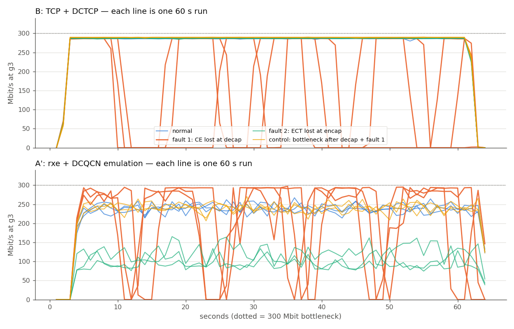
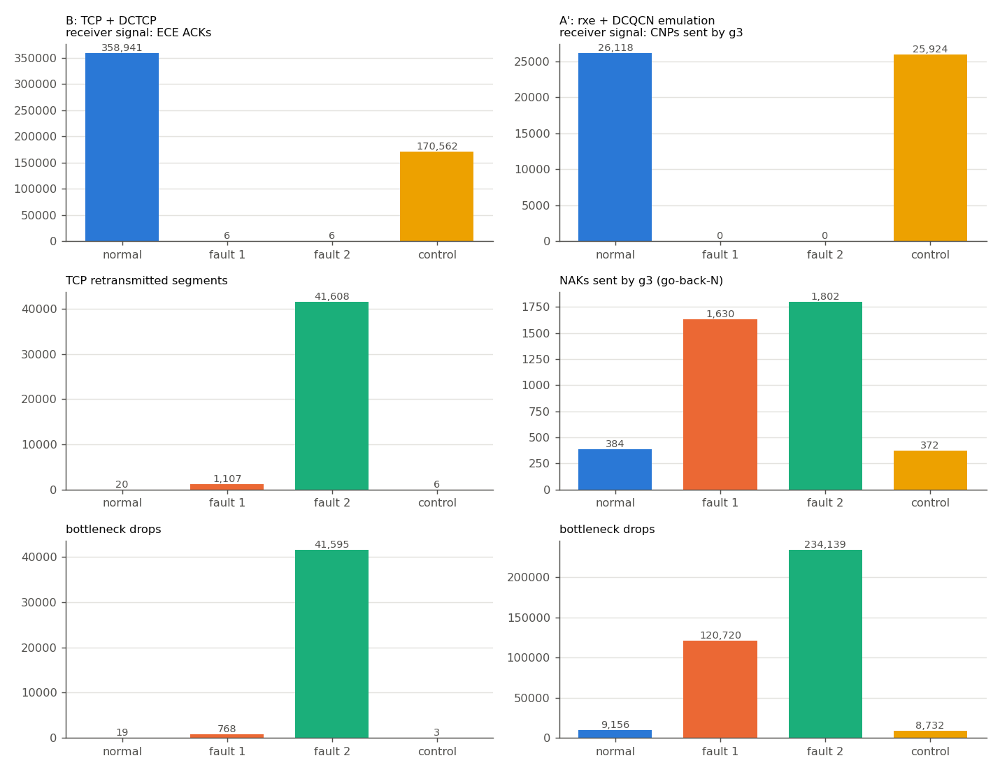

# 실험 16 2회차 — RoCE over VXLAN: ECN 전달 누락 (데스크톱, 60초 × 3회)

> [16장 본문(1회차·요약)](../README.md) · [실험 목록](../../../README.md) · 진행: 2026-10-14 ~ 10-15 · 커널 6.6.114.1-microsoft-standard-WSL2

1회차(노트북, 30초 × 2회, v1·x2·x4 컨테이너, 병목 100Mbit)와 같은 질문을 **다른 구성**으로 다시 쟀다: 서버는 rxe 가 붙는 WSL 기본 netns 의 VRF(g1~g4), 병목 300Mbit, 60초 × 3회, 그리고 rxe 트랙 두 개(그대로 / 흉내 DCQCN).
이 문서는 2회차의 상세 노트다. 처음에 18번으로 시작했다가 노트북 기록과 합치면서 여기로 옮겼다.

스파인이 VXLAN **바깥** 헤더에 찍은 혼잡 표시(CE)가 리프 VTEP에서 **안쪽** 헤더로 옮겨지지 않으면, 혼잡 제어 고리(스위치 표시 → 수신측 알림 → 송신측 감속)가 어떻게 끊기는지 잰다.

```
   g1(leaf1)  g2(leaf2)  g4(leaf4)            모두 VNI 10010, 10.10.10.0/24
        \        |        /                   gN = WSL 기본 netns 의 VRF vrN + veth xgN ↔ leafN:eth6(br10010)
         leaf1/2/4 업링크 eth1 ──── 장애2: 바깥 ECT 지우기(egress)
                 │  (spine2:eth3 은 내려서 경로를 spine1 로 고정)
               spine1 ── eth3 egress: 병목 300Mbit + RED(ecn)   ← 바깥 헤더에 CE
                 │
         leaf3 eth1 ingress ─────── 장애1: 바깥 CE → ECT(0) (디캡 직전)
         leaf3 (VTEP 디캡)
         leaf3 eth6 egress ──────── 대조군 병목 자리(디캡 이후, 안쪽 헤더에 CE)
                 │
                g3 (수신)
```

## 예측 (실험 전에 먼저 작성)

본 측정(Step 2~5) 결과를 보기 전에 적었다. 단, 스크립트 점검용 10초 시험 실행(트랙별 1회)은 먼저 돌렸고, 거기서 장애1 의 TCP 처리량이 277 → 184 Mbit 로 줄어드는 것을 이미 봤다 — 아래 Q2 예측은 핸드오프 가설을 그대로 옮긴 것이고 시험 실행을 보고 고치지 않았다. Step 1 의 답(Q1)은 측정 전에 `drivers/net/vxlan/vxlan_core.c` 를 먼저 읽어서 예측했다.

- **Q1 전달:** 리눅스 vxlan 은 캡슐화 때 `ip_tunnel_ecn_encap()` 로 안쪽 ECN 을 바깥에 복사하고(안쪽 CE 는 바깥 ECT(0)으로), 디캡 때 `INET_ECN_decapsulate()` 로 바깥 CE 를 안쪽에 옮긴다(RFC 6040). `tos` 옵션은 DSCP 만 바꾸고 ECN 처리에는 영향이 없을 것이다. → 그렇다면 장애1은 리눅스 VTEP 에서는 저절로 생기지 않는, **인위적 재현**이다.
- **rxe:** 실험 12에서 "rxe 는 ECN 을 찍지도 반응하지도 않는다"고 봤다. CE 를 받아도 CNP 를 만들지 않을 것이다 → 트랙 B(TCP+DCTCP)가 메인이 된다.
- **Q2 장애1 (핸드오프의 핵심 가설 그대로):** 스파인 표시 카운터는 정상인데 수신측 알림(ECE/CNP)이 0이 된다. 송신측이 감속하지 않아 큐가 버퍼 끝까지 차고 드랍 → 재전송 폭증 → **처리량 붕괴**.
- **Q2 장애2:** 스파인이 표시 대신 드랍한다. 손실 기반으로 떨어져 재전송이 늘고 처리량이 준다.
- **대조군:** 병목이 디캡 뒤에 있으면 표시가 안쪽 헤더에 바로 찍히므로 장애1 은 아무 영향이 없다.

## Step 0 점검 결과 (rxe DCQCN 지원 여부, 선택한 트랙)

전체 출력: [data/step0.txt](data/step0.txt) · 스크립트 [scripts/step0.sh](scripts/step0.sh)

| 항목 | 결과 |
|---|---|
| 토폴로지 | 스파인 2 + 리프 4 (eBGP 언더레이, VXLAN/EVPN). 베이스 VNI 10010 은 leaf1·leaf3 에만 있어서 실험 중에만 leaf2·leaf4 에도 만들었다 |
| rxe 위치 | rxe 는 netns 를 몰라서(실험 12) 서버를 컨테이너가 아니라 **WSL 기본 netns 의 VRF** 로 만들고, veth 반대쪽을 각 리프의 `br10010` 포트(eth6)로 꽂았다 → 리프 뒤 VNI 안 호스트 |
| 커널 / 모듈 | 6.6.114.1, `rdma_rxe`·`crc32_generic` 은 `/root/kbuild` 에서 빌드한 모듈 (실험 12 0단계), `tcp_dctcp` 있음 |
| MTU | 서버·VNI·브리지 9000, 언더레이 9500, RoCE active_mtu 4096. 8900B DF ping 통과. (베이스의 VNI MTU 1500 은 RoCE 4KB 프레임을 못 넘겨서 실험 중 9000 으로 올렸다) |
| rxe 계수기 | `ack_deferred completer_retry_err duplicate_request … sent_pkts` 16개. mlx5 의 `np_cnp_sent`·`rp_cnp_handled`·`np_ecn_marked_roce_packets` 같은 혼잡 제어 계수기가 **없다** |
| rxe 소스 | `cnp/ecn/congest` 를 쓰는 .c 파일 0개, `IB_OPCODE_CNP` 쓰는 곳 0개. BTH 의 FECN/BECN 은 `rxe_hdr.h` 에 함수만 있고 호출 0개 |
| **실측** | spine1:eth3 RED(ecn) 병목 + g1→g3 RoCE 10초(tclass 106 = DSCP 26 + ECT(0)). g3 앞(xg3)에 CE 패킷 **67,035개**가 도착. g3 → g1 은 **4,203개 전부 ACK(opcode 0x11), CNP(0x81) 0개**. g1 이 받은 CNP 0 |

**판단:** rxe 는 CE 를 받아도 CNP 를 만들지 않고, CNP 를 받는 코드도 없다. DCQCN 이 없으므로 "CE 를 못 받으면 감속을 못 한다"는 장애를 rxe 로는 만들 수 없다 → **트랙 B(TCP + DCTCP)를 메인으로 전환**했다.
트랙 A(rxe 그대로)는 "VXLAN 안쪽 RoCE 의 ECN 비트"와 "병목 손실 때 NAK/go-back-N" 관찰용으로 같이 돌렸고, 실험 13 의 흉내 DCQCN(`tools/dcqcn.py`, g3 앞에서 안쪽 CE 를 보고 UDP CNP 를 보내 송신측 htb 속도를 깎는다)을 얹은 **트랙 A'** 를 덧붙였다. A' 는 진짜 NIC 의 DCQCN 이 아니라 흉내라는 점을 결과 읽을 때 늘 같이 적는다.

## Step 1 — 신호 전달 (Q1)

전체 출력: [data/step1.txt](data/step1.txt) · CSV: [step1-encap.csv](data/step1-encap.csv), [step1-decap.csv](data/step1-decap.csv), [step1-traffic.csv](data/step1-traffic.csv)

**캡슐화 (안쪽 → 바깥).** g1 이 안쪽 TOS 를 바꿔 ping, 송신 리프 업링크 leaf1:eth1 에서 바깥 TOS 를 봤다 (조합마다 5개, 전부 같은 값).

| 안쪽으로 보낸 TOS | vxlan `tos 0`(기본) 바깥 | `tos inherit` 바깥 | `tos 0x68` 바깥 |
|---|---|---|---|
| 0x00 Not-ECT | 0x00 Not-ECT | 0x00 Not-ECT | 0x68 Not-ECT |
| 0x01 ECT(1) | 0x01 ECT(1) | 0x01 ECT(1) | 0x69 ECT(1) |
| 0x02 ECT(0) | 0x02 ECT(0) | 0x02 ECT(0) | 0x6a ECT(0) |
| 0x03 CE | **0x02 ECT(0)** | **0x02 ECT(0)** | **0x6a ECT(0)** |
| 0x6a DSCP26+ECT(0) | 0x02 ECT(0) | 0x6a | 0x6a |
| 0x6b DSCP26+CE | 0x02 ECT(0) | 0x6a | 0x6a |

ECN 두 비트는 옵션과 상관없이 늘 복사된다. 안쪽 CE 는 바깥에 CE 가 아니라 ECT(0)으로 나간다(RFC 6040 normal mode: 이미 찍힌 표시를 바깥 경로의 혼잡으로 다시 세지 않게). `tos` 옵션이 바꾸는 것은 **DSCP 뿐**이다. 기본값(0)에서는 RoCE 의 DSCP 26 이 바깥에서 사라진다 — 언더레이가 DSCP 로 RoCE 클래스를 나눈다면 그건 따로 문제가 된다(이 실험 범위 밖, 후속 과제).

**디캡 (바깥 → 안쪽).** spine1:eth3 egress 에서 pedit 으로 바깥 ECN 을 강제로 바꾸고, g3 앞(xg3)에서 안쪽 TOS 와 도착 수를 봤다. `tos 0` 과 `tos inherit` 결과가 같았다.

| 바깥 \ 안쪽 | Not-ECT | ECT(1) | ECT(0) | CE |
|---|---|---|---|---|
| Not-ECT | Not-ECT | ECT(1) | ECT(0) | CE |
| ECT(1) | Not-ECT | ECT(1) | **ECT(1)** | CE |
| ECT(0) | Not-ECT | ECT(1) | ECT(0) | CE |
| **CE** | **드랍 (0/5)** | **CE** | **CE** | CE |

바깥 CE 는 안쪽이 ECT 면 안쪽 CE 로 옮겨지고, 안쪽이 Not-ECT 면 표시를 전할 방법이 없어 **패킷을 버린다**(커널 로그 `vxlan: non-ECT from 10.255.1.1 with TOS=0x3`, 37줄). RFC 6040 의 디캡 표 그대로다.

**실제 병목에서.** spine1:eth3 에 RED(ecn) 를 걸고 TCP(DCTCP)·RoCE 를 5초씩 흘려, 스파인 표시 / leaf3 업링크 바깥 CE / g3 앞 안쪽 CE 를 셌다.

| vxlan tos | 트래픽 | 스파인 표시 | leaf3:eth1 바깥 CE | xg3 안쪽 CE | 송신 리프 업링크 바깥 ECT(0) |
|---|---|---|---|---|---|
| 0 | TCP | 42,491 | 42,491 | **42,491** | 2000/2000 (표본) |
| 0 | RoCE | 46,578 | 46,578 | **46,578** | 1999/1999 |
| inherit | TCP | 42,639 | 42,639 | 42,639 | 2000/2000 |
| inherit | RoCE | 46,801 | 46,801 | 46,801 | 2000/2000 |
| 0x68 | TCP | 42,337 | 42,337 | 42,337 | 2000/2000 |
| 0x68 | RoCE | 46,466 | 46,466 | 46,466 | 2000/2000 |

세 숫자가 한 개도 어긋나지 않는다. **리눅스 vxlan 은 기본값에서 CE 를 안쪽으로 옮긴다.** 따라서 아래 장애1 은 "바깥 CE 를 안쪽에 반영하지 않는 VTEP"(RFC 6040 이전 터널 규격들은 디캡 때 바깥 ECN 을 무시하는 동작을 허용했다)을 tc pedit 으로 **흉내 낸 인위적 재현**이다.
(Step 0·1 의 RoCE 병목 버퍼는 4MB, Step 2~5 는 1MB. 표시 전달만 보는 단계라 결과에 영향이 없다.)

## Step 2~5 — 정상 · 장애1 · 장애2 · 대조군 (Q2)

스크립트: [run-all.sh](scripts/run-all.sh) → 시나리오마다 [bottleneck.sh](scripts/bottleneck.sh)·[inject-decap.sh](scripts/inject-decap.sh)·[inject-encap.sh](scripts/inject-encap.sh)·[control.sh](scripts/control.sh)로 상태를 만들고 [measure.sh](scripts/measure.sh)가 60초 잰다(1초 계수기 [sampler.py](scripts/sampler.py)). 회차 순서는 정상 → 장애1 → 장애2 → 대조군을 한 바퀴로 세 바퀴.
집계 [analyze.py](scripts/analyze.py) → [data/summary.csv](data/summary.csv)(회차별), [data/summary-mean.csv](data/summary-mean.csv)(평균·표준편차), `data/timeseries-<트랙>.csv`(1초).

- 경로 고정: spine2:eth3 을 내려 leaf3 로 가는 VXLAN 을 전부 spine1:eth3 하나로 (병목이 한 곳).
- 병목: spine1:eth3 egress htb 300Mbit + RED(ecn). TCP 는 DCTCP 식 계단(평균 큐 30KB 넘으면 전부 표시, 한도 1MB), RoCE 는 실험 13 문턱(100~300KB, 한도 1MB).
- 대조군: 같은 큐를 leaf3:eth6(디캡 뒤, g3 앞) egress 로 옮기고 장애1 필터는 그대로 켠다.

### 트랙 B — TCP + DCTCP (메인), 60초 × 3회 평균

| | 정상 | 장애1 디캡 CE 누락 | 장애2 캡슐화 ECT 누락 | 대조군 + 장애1 |
|---|---|---|---|---|
| 합계 처리량 (수신, Mbit/s) | 276.5 | **144.1 (−48%)** | 276.7 | 286.3 |
| 병목 표시 | 511,256 | **765,293** | 0 | (leaf3:eth6) 186,043 |
| 병목 드랍 | 19 | 768 | **41,595** | 3 |
| leaf3 업링크 바깥 CE | 511,256 | 764,607 | 0 | 0 |
| g3 앞 안쪽 CE | 511,256 | **0** | 0 | 582,480 ※ |
| 수신측 알림 ECE | 358,941 | **6** | 6 | 170,562 |
| 재전송 | 20 | 1,107 | **41,608** | 6 |
| 병목 큐 평균 | 30KB | **416KB** | 24KB | 32KB |
| 송신 srtt 평균 / cwnd 평균 | 0.9ms / 11KB | **22.3ms / 133KB** | 1.0ms / 11KB | 1.0ms / 12KB |
| 전면 정지(합계 < 10Mbit) | 0 | **3·3·4번, 31·19·21초** | 0 | 0 |

※ 대조군의 안쪽 CE 는 GRO 로 묶인 skb 하나에 찍힌 표시가 세그먼트 수만큼 세어진 값이다(flower 계수기는 gso_segs 로 센다). 1회차에서 추정한 것과 같은 현상.
ECE 6 은 연결 셋의 SYN/SYN-ACK 이다(ECN 협상 플래그).



**장애1 은 한 번 무너지는 게 아니라 주기적으로 멈춘다.** 1회차 30초 창에서는 정지가 한 번(약 15초)이었는데, 60초 창에서는 세 회차 모두 "약 8초 전속 → 3~14초 완전 정지"가 3~4번 반복됐다(위 그림 주황 선). 패턴은 1회차와 같다: ECE 가 0 이라 DCTCP 의 cwnd 가 계속 커지고(평균 133KB, 정상의 12배), 큐가 1MB 한도에 닿으면 꼬리 드랍 수백 개가 세 흐름을 같은 순간에 RTO 로 보낸다. 세 송신의 1초 처리량이 같은 초에 0 이 되고 같은 초에 돌아온다(`data/timeseries-tcp.csv` 의 tx_g1/g2/g4).
**정지 구간에도 병목 드랍이 초당 1~4개 남는다(큐는 0).** 1회차의 "설명 못 한 것"과 같은 현상이 여기서도 3회 모두 나왔다(정지 구간 드랍 합 24·29·27개). 재전송 타이머가 쏜 패킷 자체가 비어 있는 큐에서 버려지고 있다는 뜻이라, 정지가 백오프로 길어지는 이유와 맞물린다. 원인 좁히기용 [scripts/diag-stall.sh](scripts/diag-stall.sh)(RED xstats 0.2초 간격 + 병목 앞뒤 Not-ECT 캡처)를 만들었지만, **WSL 이 멈춰 아직 돌리지 못했다**(아래 후속 과제).

장애2 는 TCP 에는 거의 상처가 없다. 표시 대신 드랍이 41,595개 났지만 SACK 으로 빠진 조각만 다시 보내 처리량은 정상과 같다(276.7). srtt 도 1.0ms — 드랍이 큐를 30KB 근처에서 잘라 주므로 오히려 지연은 정상과 같다.

### 트랙 A′ — rxe + 흉내 DCQCN, 60초 × 3회 평균

| | 정상 | 장애1 | 장애2 | 대조군 + 장애1 |
|---|---|---|---|---|
| 합계 처리량 (perftest, Mbit/s) | 213.4 | **123.8 (−42%)** | **23.0 (−89%)** | 213.6 |
| 수신측 알림 CNP | 26,118 | **0** | 0 | 25,924 |
| 병목 표시 / 드랍 | 167,403 / 9,156 | 496,978 / **120,720** | 0 / **234,139** | (leaf) 169,522 / 8,732 |
| g3 NAK (go-back-N) | 384 | 1,630 | 1,802 | 372 |
| 병목 큐 평균 | 134KB | **510KB** | 69KB | 120KB |
| 전면 정지 | 0 | 4·4·5번, 1~3초씩 | 0 | 0 |



흉내 DCQCN 에서도 장애1 은 같은 꼴이다: CNP 가 0 이 되자 송신 셋이 1000Mbit 상한 그대로 보내고, 큐가 1MB 를 넘쳐 드랍 12만 개, go-back-N NAK 4배, 짧은 정지 4~5번.
**TCP 와 정반대인 곳은 장애2 다.** RoCE 는 장애2 에서 −89% 로 장애1 보다 훨씬 심하게 무너졌다. 바깥이 Not-ECT 라 RED 가 평균 큐 100KB 부터 확률적으로 버리기 시작하고(드랍 23만 개), RC 전송의 go-back-N 은 패킷 하나를 잃을 때마다 그 뒤 전부를 다시 보낸다. TCP 는 같은 드랍을 SACK 으로 거의 공짜로 흡수했다. **같은 비트 하나가 지워져도, 전송 계층이 손실에 얼마나 약한가에 따라 어느 장애가 더 아픈지가 뒤집힌다.**

### 트랙 A — rxe 그대로

WSL 재부팅으로 첫 시도(정상 1회 + 장애1 일부)가 끊겼고, 다시 돌리던 회차도 두 번째로 WSL 이 멈추며 결과를 가져오지 못했다(WSL 디스크 안 `data/runs/roce/` 에 일부 남아 있을 수 있다). 첫 시도의 정상 1회: 합계 145Mbit, 병목 드랍 156,550, NAK 1,946 — rxe 는 CE 에 반응하지 않으므로 1MB 버퍼를 넘쳐 정상 상태에서도 드랍이 난다. 장애1 이 rxe 그대로에 아무 차이를 못 만든다는 건 Step 0 에서 이미 정해진 답이라, 이 트랙의 남은 값은 장애2 의 go-back-N 비교용이다.

## 1회차와 비교

| | 1회차 (노트북) | 2회차 (데스크톱) |
|---|---|---|
| 구성 | v1·x2·x4 컨테이너, 병목 100Mbit, RED 30~45KB / 600KB | rxe 붙는 VRF g1·g2·g4, 병목 300Mbit, RED 30~31KB / 1MB |
| 회차 | 30초 × 2 | 60초 × 3 |
| 장애1 처리량 | −50% | −48% |
| 장애1 정지 | 한 번, 약 15초 | 3~4번, 3~14초씩 반복 |
| 정지 중 빈 큐 드랍 | 초당 1~3개 (원인 미확정) | 초당 1~4개 (같음, 원인 미확정) |
| 장애2 (TCP) | 처리량 그대로, 재전송 9,852 | 처리량 그대로, 재전송 41,608 |
| RoCE 쪽 | rxe 점검만 (tclass 0 회차 실패) | 흉내 DCQCN: 장애1 −42%, **장애2 −89%** |
| Q1 | 리눅스 vxlan 은 기본값에서 전달 | 같음 + 4×4 디캡 표(바깥 CE + 안쪽 Not-ECT → 드랍) |

구성이 달라도 장애1 의 모양(ECE 0 → cwnd 폭주 → 한도 드랍 → 동시 RTO → 전면 정지)은 같았다. 길게 재 보니 그 정지가 **되풀이**된다는 게 새로 보였다.

## 원상복구

각 시나리오 끝에서 병목·장애 필터는 run-all.sh 가 걷었다. 패브릭 전체 원복(`scripts/teardown.sh`: spine2:eth3 올림, VNI 확장·MTU·VRF·rxe 장치 제거, 상태 재확인)은 **WSL 이 멈춰 아직 돌리지 못했다.** WSL 을 다시 띄우면 컨테이너가 새로 올라오므로 실험 흔적(tc·VRF·eth6)은 남지 않지만, 확인 기록은 다음 실행 때 `data/teardown.txt` 로 남긴다.

## 후속 과제

- `diag-stall.sh` — 정지 구간 빈 큐 드랍의 정체 (RED early/pdrop 중 무엇이 오르는가, 버려지는 것이 Not-ECT 인가)
- rxe 그대로 트랙 60초 × 3회 마저, teardown 기록
- 장애1 을 흐름 하나에만 걸어 공정성 보기 (1회차 후속 과제와 같음)
