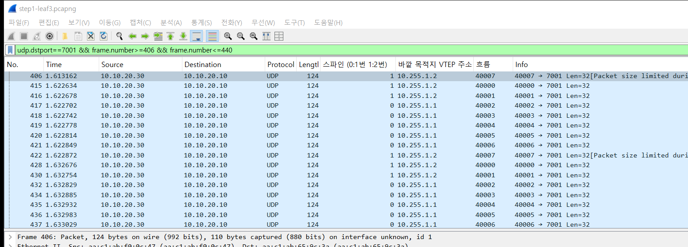
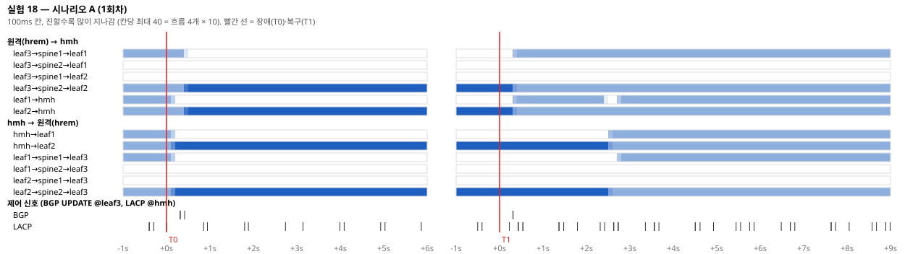
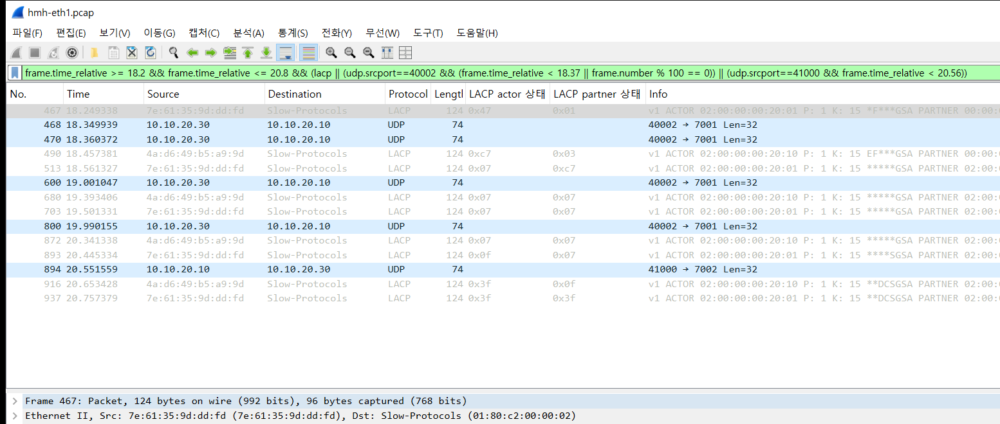
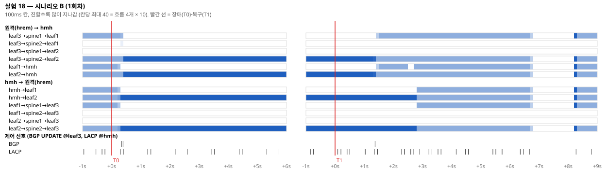
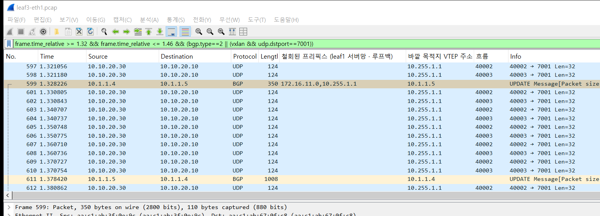
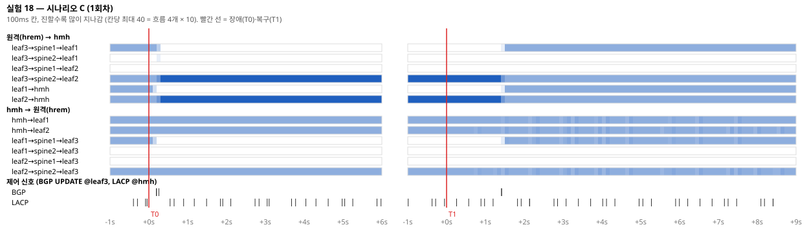
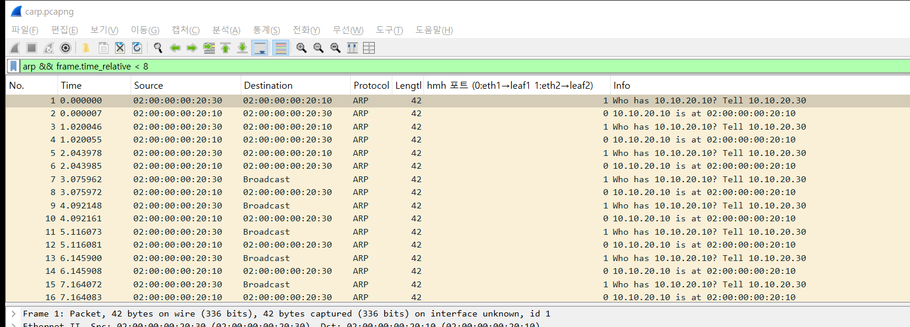
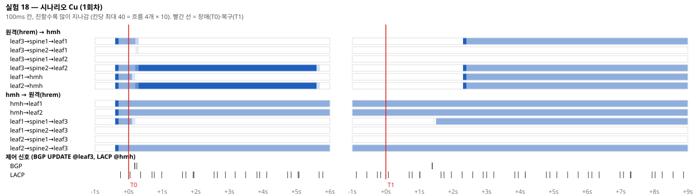
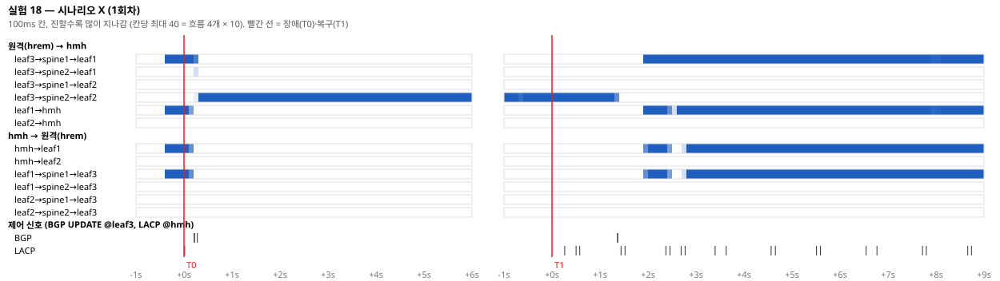

# 실험 18 — EVPN ESI-LAG: 리프 한 대가 죽을 때 서버 이중화

> [실험 목록](../../README.md) · 앞 장 [06 링크 다운 수렴](../../_completed/06-link-down-convergence/README.md), [08 EVPN-VXLAN 패킷 추적](../08-packet-life-evpn/README.md) · 실행 기록 [capture/run-output.txt](capture/run-output.txt)

**한 줄 요약 (면접용)**: leaf1을 통째로 내렸을 때 ESI-LAG 구성은 원격 → 서버 흐름의 절반만 **0.12~0.13초**(10ms 탐침 24~26개) 끊겼고, 서버 → 원격은 0.01초 이하였다. 같은 서버를 leaf1 한 대에만 꽂은 대조군은 leaf1이 꺼져 있던 **15~17초 내내** 모든 흐름이 끊겼다. 대신 ESI-LAG는 **리프가 돌아올 때** 흐름 절반이 1.3~2.4초 끊겼고, 업링크만 죽은 리프는 서버 쪽 링크를 계속 붙잡아 **장애 내내 블랙홀**을 만들었다.

K8s·Ceph 데이터센터 설계안의 서버 이중화(서버를 리프 두 대에 한 줄씩, 피어링크 없이 EVPN multihoming)를 검증했다.
서버가 bond 하나로 리프 두 대에 붙고, 두 리프는 같은 ES(Ethernet Segment) 번호를 광고한다. 원격 리프는 서버 MAC을 VTEP 하나가 아니라 ES로 기억하고, ES에 속한 VTEP 묶음 안에서 흐름을 나눈다.
리프 한 대가 빠지면 그 리프의 Type-1(EAD) 경로 하나가 철회되고, 원격 리프는 MAC 경로를 하나하나 고치지 않고 묶음에서 그 VTEP만 뺀다(mass withdraw).

## 장애 구성

```
        spine1                    spine2
        /    \                    /    \
   leaf1      leaf2          (leaf1·2와 같은 연결)      leaf3
  (AS 65011) (AS 65012)                                (AS 65013)
     eth5      eth5                                       eth5
       \       /                                           |
   eth1 \     / eth2                                       |
        hmh (bond0, LACP)                                hrem
        10.10.20.10                                      10.10.20.30
  leaf1·leaf2 bond1: 같은 ES 03:02:00:00:00:20:01:00:00:01, 같은 LACP 시스템 MAC
```

| 항목 | 값 |
|---|---|
| 리프 쌍 / 원격 | leaf1(leaf-a) · leaf2(leaf-b) / leaf3 |
| 실험 VLAN / VNI / 서브넷 | VLAN 20 → VNI 10020 (DESIGN.md의 `10000 + VLAN`), 10.10.20.0/24, RT `65000:10020` |
| ES | `evpn mh es-id 1`, `evpn mh es-sys-mac 02:00:00:00:20:01` (= 두 리프 bond1의 `ad_actor_system`) |
| 서버 bond | hmh `bond0`: 802.3ad, `lacp_rate fast`, `miimon 100`, `xmit_hash_policy layer3+4`. 리프 쪽 bond1도 802.3ad·fast |
| 서버 포트 | 리프마다 `eth5` (eth3 = h, eth4 = v1·v3 가 이미 씀) |
| 측정 | 단방향 UDP 탐침: 방향마다 흐름 4개(출발 포트만 다름) × 10ms 간격. 손실 개수 × 10ms = 끊긴 시간. ping `-i 0.01`도 양방향으로 같이 |
| 캡처 (1회차) | hmh:eth1·eth2(서버 두 줄), leaf3:eth1·eth2(원격 리프의 두 스파인 쪽). 같은 탐침 패킷이 어느 리프·스파인을 지났는지 네 곳에서 맞춰 본다 |
| 상태 기록 | 50ms마다 leaf3의 커널 FDB(hmh MAC → 어느 VTEP 묶음), hmh bond의 두 줄 상태, leaf1·leaf2 protodown. 바뀔 때만 `events.txt`에 |

새 이름 규칙 두 가지: 서버는 기존 규칙(`h<리프번호>`)으로 이름을 붙일 수 없어서(리프 두 대에 걸침) `hmh`, `hrem`으로 했다. 이 둘은 containerlab 토폴로지에 넣지 않고 setup.sh가 컨테이너를 띄워 veth로 붙인다. 베이스 `clos.clab.yml`과 `configs/`는 건드리지 않는다.

## 실행

```bash
cd /root/labs/clos-fabric
./scripts/evpn-apply.sh                               # 베이스 EVPN (VNI 10010) — 이 장은 그 위에 VNI 10020을 얹는다
experiments/_wip/18-evpn-esi-lag/setup.sh             # hmh·hrem, bond, VNI 10020, ES
experiments/_wip/18-evpn-esi-lag/run.sh               # step0 step1 A B C Cu X (약 15분), 하나만: run.sh B
experiments/_wip/18-evpn-esi-lag/arpcheck.sh          # C 의 ARP 확인 (1분)
experiments/_wip/18-evpn-esi-lag/restore.sh           # 원상 복구
```

회차마다 탐침을 켜고 3초 뒤 장애(T0), 15초 유지, 원복(T1 — 시나리오 D), 20초 더 본다. 시나리오마다 3회, 1회차만 캡처와 스냅숏(`show evpn es`, Type-1·Type-4, MAC)을 남긴다.

## 시나리오별 결과

숫자는 단방향 UDP 탐침 기준. 끊김 열은 흐름 하나에서 연속으로 잃은 시간의 최댓값, 흐름 열은 손실을 본 흐름 수(4개 중)다. 원자료 [capture/<시나리오>/results.csv](capture/A/results.csv).

### Step 1. 정상 상태 — 주소록과 흐름 나누기

- leaf1·leaf2 모두 ES `03:02:00:00:00:20:01:00:00:01`을 Local로 갖고, **DF는 leaf1**(선호도 32767로 같아 주소가 낮은 쪽). leaf2는 non-df라 BUM을 서버로 내보내지 않는다.
- leaf3은 이 ES를 Remote, VTEP `10.255.1.1,10.255.1.2`로 본다. hmh MAC은 VTEP이 아니라 **ESI를 다음 홉으로** 갖는다(`show evpn mac`).
- leaf3이 받은 Type-1은 리프마다 per-ES(EthTag 4294967295, `ESI-label-Rt`) + per-EVI(EthTag 0) 두 개, 스파인 두 경로라 8줄. Type-4(ES 경로, DF 선출용)는 리프마다 하나씩 4줄.
- 흐름 8개를 흘려 보면 원격 → hmh는 leaf3이 흐름마다 leaf1·leaf2 중 하나를 고르고(5:3), hmh → 원격은 bond 해시가 4:4로 나눈다([capture/run-output.txt](capture/run-output.txt) Step 1). 리프와 스파인의 짝은 늘 같다(leaf3 → leaf1은 spine1, → leaf2는 spine2). 리눅스 vxlan이 원격 VTEP마다 경로를 캐시하기 때문이다(01장에서 본 현상).



leaf3의 두 업링크 캡처를 합친 화면(`mergecap -I none`, 0 = spine1 쪽 eth1, 1 = spine2 쪽 eth2). 같은 10ms 안에 흐름 40000·40001·40007은 바깥 VTEP `10.255.1.2`(leaf2)로 spine2를, 40002~40006은 `10.255.1.1`(leaf1)로 spine1을 탄다. 안쪽 목적지는 모두 hmh(10.10.20.10) 하나다.

### A. 서버 쪽 링크 한 줄 끊기

**주입**: `leaf1:eth5 down` (hmh의 eth1 쪽 캐리어가 사라진다). T1에 다시 up.

**증상** (3회 평균 / 최대)

| | 장애 중 손실 | 끊김 | 흐름 | 복구 때 손실 | 끊김 | 흐름 |
|---|---|---|---|---|---|---|
| 원격 → hmh | 55개 | **277 / 310ms** | 2/4 | 481개 | **2.40 / 2.41초** | 2/4 |
| hmh → 원격 | 27개 | 53 / 160ms | 0~4/4 | 14개 | 70 / 210ms | 0~2/4 |
| ping 두 방향 | 0 | 0 | | 0 | 0 | |



**추적 과정**
1. hmh bond는 T0+0.25~0.30초에 eth1을 down으로 봤다(miimon 100ms + 폴링 간격). hmh → 원격 흐름은 그 순간 eth2로 옮겨 가서 거의 손실이 없다. 3회차의 82개(4흐름 모두 160ms)는 같은 순간 WSL이 잠깐 멈춘 것과 겹친다.
2. leaf1은 bond1이 내려가자 per-ES Type-1을 철회했고(leaf3의 Type-1 8 → 6줄, Type-4 4 → 2줄), leaf3의 FDB 묶음은 T0+0.45~0.56초에 `leaf1+leaf2 → leaf2`로 줄었다. 그 사이 leaf1으로 간 흐름 2개가 250~310ms 잃었다. hmh MAC 경로(Type-2)는 그대로 ESI를 가리켰다 — MAC을 고치지 않고 묶음만 줄였다.
3. DF가 leaf1 → leaf2로 넘어갔다(스냅숏 `snap-1-fault.txt`).
4. **복구가 장애보다 길었다.** 처음엔 원복이 BGP 재광고 때문에 늦다고 봤는데 틀렸다. leaf3은 T1+0.35~0.43초에 벌써 leaf1을 묶음에 되돌렸고, 캡처를 보면 그때부터 leaf1 → hmh:eth1로 패킷이 도착한다. 그런데 hmh의 수신 탐침에는 2.4초 동안 안 잡힌다. hmh → leaf1 송신이 다시 시작되는 것도 T1+2.5초다.

**원인·복구**: 리눅스 802.3ad는 줄이 올라온 뒤 wait-while 타이머(2초)를 기다렸다가 그 줄을 묶음에 넣고 수신·송신(collecting/distributing)을 시작한다. 그 전까지 eth1로 들어온 프레임은 bond가 버린다. 반면 FRR은 bond1의 링크 상태만 보고 ES를 다시 광고하므로, 원격 리프가 아직 LACP가 끝나지 않은 줄로 흐름 절반을 2초 넘게 보낸다.



hmh:eth1 캡처, T1 = 18.025초(LACP와 흐름 40002만, 중간은 100번째마다 하나). 18.35초(T1+0.32)부터 leaf1이 흐름 40002를 hmh에 보내기 시작한다 — leaf3이 이미 leaf1을 다시 쓰고 있다. 하지만 이 줄의 LACP는 양쪽 모두 actor 상태 `0x07`(Activity·Timeout·Aggregation)에 머문다. 20.445초에 leaf1 쪽이 `0x0f`(Synchronization), 20.653초에 hmh 쪽이 `0x3f`(+Collecting·Distributing)가 된다. 그 사이 도착한 40002 패킷은 bond가 받아 주지 않아 탐침 수신 기록에 하나도 없다. hmh가 이 줄로 처음 보내는 패킷(41000 → 7002)은 20.55초, T1+2.53초다.

**한 줄 교훈**: 서버 링크 장애는 0.3초 안에 넘어가지만, 링크가 돌아올 때 LACP 대기 2초 동안 흐름 절반이 버려진다. ping 하나로는 이것도 못 본다(한 흐름이라 해시가 leaf2로 가면 손실 0).

### B. 리프 a 통째 장애

**주입**: leaf1의 모든 포트(eth1~eth5)를 `ip -batch`로 한 번에 down — 이웃(스파인·hmh) 입장에선 캐리어가 사라지는 전원 꺼짐과 같다. `docker stop`은 netns가 사라지며 veth가 지워져 랩을 재배포해야 하고, `docker pause`는 커널이 계속 포워딩해서(07장) 리프 장애가 아니다.

**증상** (3회 평균 / 최대)

| | 장애 중 손실 | 끊김 | 흐름 | 복구 때 손실 | 끊김 | 흐름 |
|---|---|---|---|---|---|---|
| 원격 → hmh | 25개 | **123 / 130ms** | 2/4 | 274개 | **1.37 / 1.42초** | 2/4 |
| hmh → 원격 | 1개 | 7 / 10ms | 0~2/4 | 33개 | 103 / 190ms | 0~4/4 |
| ping 두 방향 | 0 | 0 | | 0~5 | 0~10ms | |





leaf3:eth1(spine1 쪽) 캡처. T0(주입 명령 시작)은 0.999초인데 nsenter를 거친 링크 down이 실제로 먹은 건 그보다 늦다. 599번(1.328초)이 spine1 → leaf3 UPDATE로, **leaf1의 서버망 172.16.11.0/24와 루프백 10.255.1.1/32를 철회**한다. VTEP 주소 자체가 언더레이에서 사라지는 것이다. 그런데 leaf3은 그 뒤 50ms 동안(612번, 1.381초까지) 흐름 40002·40003을 여전히 10.255.1.1로 캡슐화해 보낸다. 커널 FDB 묶음에서 leaf1이 빠지는 건 EVPN 철회를 처리한 뒤라서, 그 사이 패킷은 spine1에서 버려진다. 장애 중 손실 120ms는 링크가 실제로 내려간 뒤 이 철회가 도착하고 묶음이 갱신되기까지의 시간이다.

**추적 과정**
1. A보다 장애 쪽이 빨랐다(277ms → 123ms). leaf1이 링크를 잃고 철회를 보내는 단계가 없다. 스파인이 leaf1 쪽 캐리어를 잃자마자 leaf1에서 받은 경로(루프백, Type-1·2·3·4)를 한꺼번에 철회했고, leaf3은 leaf1 VTEP을 묶음에서 뺐다. 이것이 mass withdraw의 실제 모습이다 — hmh MAC 하나하나가 아니라 ES 묶음에서 VTEP 하나가 빠진다.
2. leaf3의 Type-1은 8 → 4줄(leaf1 것 전부), Type-4는 4 → 2줄. DF는 leaf2로 넘어갔다.
3. hmh → 원격은 bond가 캐리어 손실을 보고 eth2로 옮기니 10ms 이하.
4. 복구: leaf3이 leaf1을 묶음에 되돌린 건 T1+1.0~1.5초(BGP가 다시 붙는 시간). hmh가 eth1을 받아들이는 건 A와 같은 T1+2.5초. 그 차이 1.0~1.4초 동안 흐름 절반이 버려졌다. A보다 짧은 건 BGP 재접속이 LACP 대기의 일부를 가려 줬기 때문이다.

**원인·복구**: 장애 쪽은 캐리어 → 스파인 BGP 철회 → leaf3 묶음 갱신으로 0.12초. 복구 쪽은 A와 같은 LACP 대기 2초에서 BGP 재접속 시간을 뺀 만큼.

**한 줄 교훈**: 리프가 죽는 순간은 0.12초면 넘어간다. 아픈 건 리프가 돌아오는 순간이다.

### C. 리프 a 업링크만 장애 (uplink 추적 없음)

**주입**: leaf1의 eth1·eth2(스파인 쪽)만 down. 서버 쪽 eth5와 LACP는 살아 있다.

**증상** (회차별 — 회차마다 크게 달라서 평균을 내지 않았다)

| 회차 | 원격 → hmh 장애 중 | hmh → 원격 장애 중 | 원격 → hmh 복구 | hmh → 원격 복구 |
|---|---|---|---|---|
| 1 | 130ms, 2/4 흐름 | **18.0초(장애 내내), 2/4** | 50ms | 1.47초 |
| 2 | **8.2초, 4/4** | **15.0초(장애 내내), 2/4** | 1.49초 | 1.50초 |
| 3 | **6.5초, 4/4** | **15.0초(장애 내내), 2/4** | 2.72초 | 3.03초 |
| ping (원격→hmh / hmh→원격) | 33~994개 | 391~990개 | | |



**추적 과정**
1. hmh → 원격: 예상대로 블랙홀. hmh bond는 leaf1 쪽 줄이 멀쩡하니(캐리어·LACP 둘 다 살아 있음) 흐름 절반을 계속 eth1로 보내고, leaf1은 패브릭으로 나갈 길이 없어 버린다. 장애가 끝날 때까지 안 풀린다.
2. 원격 → hmh: leaf1의 BGP가 끊기며 leaf3은 0.3초 만에 leaf2만 쓴다. 그러니 1회차처럼 0.13초면 끝나야 하는데, 2·3회차는 **4개 흐름이 모두** 6~8초 끊겼다. 처음엔 DF 문제(BUM을 맡은 leaf1이 고립돼 ARP 요청이 hmh에 안 닿음)를 의심했다. 스냅숏을 보니 leaf2는 장애 중 DF가 되어 있었다(leaf1은 고립돼 자기도 DF라고 믿고 있었다 — 둘 다 df). 그래서 요청 쪽 문제는 아니다.
3. 따로 확인([arpcheck.sh](arpcheck.sh), [capture/C-arp/out.txt](capture/C-arp/out.txt), 장애 45초): hrem의 hmh 이웃 항목이 STALE → DELAY → PROBE로 넘어가며 유니캐스트 ARP 요청을 보내면, 요청은 leaf2 → hmh:eth2로 잘 도착한다. 그런데 **hmh의 ARP 응답은 매번 eth1(leaf1)로 나간다.** `layer3+4` 해시는 IP가 아닌 프레임(ARP)에는 MAC 기반 해시를 쓰므로 hmh → hrem ARP는 늘 같은 줄을 탄다. 응답이 고립된 leaf1에서 버려지고, hrem의 이웃 항목은 T0+5.5초에 INCOMPLETE가 된 뒤 원격 → hmh 흐름 4개가 장애 내내(+5.2 ~ +48초) 전부 끊겼다. 1회차는 이웃 항목이 마침 REACHABLE이라 장애 15초 안에 만료되지 않았던 것이다.



arpcheck의 hmh 두 줄 캡처를 합친 화면(0 = eth1 → leaf1, 1 = eth2 → leaf2), 시간 0 = T0+2.16초. hrem의 ARP 요청은 매번 살아 있는 leaf2를 거쳐 eth2(1)로 들어오고, hmh의 응답은 매번 eth1(0)으로, 즉 업링크가 죽은 leaf1으로 나간다. 처음 셋은 이웃 항목 PROBE 단계의 유니캐스트 요청, 7번부터는 INCOMPLETE 뒤의 브로드캐스트 요청이다. 응답이 한 번도 hrem에 닿지 않는다.

**원인·복구**: 업링크를 잃은 리프가 서버 쪽 LACP를 계속 유지해서 생긴다. 흐름 절반이 버려지는 데서 끝나지 않고, ARP처럼 늘 같은 줄을 타는 프레임이 그 줄에 걸리면 나머지 흐름까지 같이 죽는다. 복구는 업링크 BGP가 다시 붙는 1.5초 남짓.

**한 줄 교훈**: 업링크를 잃은 리프는 죽은 리프보다 위험하다. 서버는 그 리프가 살아 있다고 믿는다.

### Cu. C + `evpn mh uplink` 추적

**주입**: C와 같고, leaf1·leaf2의 eth1·eth2에 `evpn mh uplink`를 켰다. 업링크가 다 죽으면 zebra가 ES bond를 protodown 해서 서버가 그 줄을 빼게 하려는 설정이다.

**증상**: C와 같았다. hmh → 원격 흐름 2개가 3회 모두 장애 내내(15.0~16.5초) 끊겼고, 원격 → hmh는 11.0초(4/4) / 6.4초(4/4) / 0.12초(2/4). 감시 기록에 protodown이 한 번도 찍히지 않았다.



**추적 과정**: zebra는 업링크 장애를 정확히 알았다. 업링크를 내리자 `show evpn`이 `uplink-active-cnt: 0`, `protodown reasons: (uplinks-down)`를 보였다. 하지만 `show interface bond1`은 `protodown: off (n/a)`. 손으로 `ip link set bond1 protodown on`을 해 보면 `Protodown not supported by device` — **이 커널의 bond와 veth는 protodown을 지원하지 않는다**(vxlan 장치는 된다). 실제 스위치 ASIC 드라이버는 protodown을 포트의 물리 링크 다운으로 바꾸지만, 이 랩에서는 FRR이 결정을 내려도 커널에 적용할 방법이 없다.

**원인·복구**: 랩의 한계다. 설정 자체는 맞고 FRR도 동작했지만 마지막 단계(포트를 실제로 내리기)가 veth에서 안 된다. 실제 장비에서 동작했다면 hmh는 leaf1 줄의 캐리어를 잃었을 것이고, 결과는 B(서버 → 원격 10ms 이하)에 가까웠을 것이다 — 이건 측정이 아니라 추정이다.

**한 줄 교훈**: uplink 추적은 C의 블랙홀을 막는 설정이지만, protodown을 받아 주는 하드웨어가 있어야 효과가 있다. 랩에서 검증하려면 protodown 대신 서버 포트를 직접 내리는 스크립트로 흉내 내야 한다(이번엔 하지 않았다).

### D. 복구

A~C의 원복(T1)이 D다. 위 표의 복구 열을 모으면:

| 원복 | 원격 → hmh 끊김 (흐름 2개) | 왜 |
|---|---|---|
| A 서버 링크 up | 2.40초 | leaf1이 0.4초 만에 ES를 재광고 → hmh는 LACP 대기 2초 동안 그 줄을 버림 |
| B 리프 전체 up | 1.37초 | BGP 재접속 1.0~1.5초가 LACP 대기 일부를 가림 |
| C 업링크 up | 0.05~2.7초 | 업링크 BGP 재접속 1.5초. 회차 편차는 ARP 상태에 따라 |

DF는 A·B에서 장애 중 leaf2로 넘어갔다가 원복 뒤 leaf1로 돌아왔다(선호도가 같아 낮은 주소가 이긴다). 이 탐침은 유니캐스트라 DF가 바뀌는 순간의 BUM 손실은 따로 재지 않았다.

### Step 3. 대조군 X — ESI 없이 leaf1에만

**주입**: ES 설정을 지우고 leaf2:eth5를 내려 hmh를 leaf1 한 줄짜리 서버로 만든 뒤 B와 똑같이 leaf1 전원 꺼짐.

| 회차 | 장애 중 (두 방향 모두) | 원격 → hmh 복구 | hmh → 원격 복구 |
|---|---|---|---|
| 1 | 4/4 흐름, 16.5초 (장애 내내) | 1.42초 | 1.93초 |
| 2 | 4/4 흐름, 15.0초 (장애 내내) | 3.18초 | 5.21초 |
| 3 | 4/4 흐름, 16.9초 (장애 내내) | 1.49초 | 3.48초 |



leaf3의 hmh MAC은 T0+0.4초에 주소록에서 사라졌고(Type-2 철회), 그 뒤 leaf3은 모르는 목적지로 BUM 플러딩을 했다(그림에서 leaf3 → spine2 → leaf2 줄이 장애 중에도 진한 이유 — leaf2엔 hmh가 없으니 버려진다). 복구는 BGP 재접속 뒤 MAC을 다시 배울 때까지. ESI-LAG의 0.12초와 비교할 숫자가 이것이다.

BFD 비교는 하지 않았다. 이 장의 장애는 전부 캐리어가 사라지는 장애라 BGP가 즉시 알고, BFD가 줄여 줄 시간이 없다. BFD가 의미 있는 건 링크는 살아 있고 장비만 멈춘 경우로, [07장](../../_completed/07-spine-freeze-bfd/README.md)에서 이미 쟀다.

## 측정에서 주의할 점

- **ping은 이 실험에 맞지 않는다.** ping은 흐름 하나라 해시가 살아 있는 리프로 가면 장애를 통째로 놓친다. A·B에서 ping 손실은 6회 중 5회가 0이었다. 반대로 C·X처럼 오래 끊기면 iputils ping은 응답이 없을 때 보내는 간격이 늘어나 손실 개수 × 10ms가 실제 시간보다 작게 나온다. `ping -i 0.01` 숫자는 run-output에 그대로 남겼지만 결론은 UDP 탐침으로 냈다.
- WSL이 가끔 수백 ms 멈춘다. 탐침은 보낸 시각을 실어 보내서, 예정보다 100ms 넘게 늦게 보낸 패킷을 따로 세어 run-output에 `※`로 남겼다(손실로 세지 않는다). 그림에서 모든 줄이 동시에 비었다가 진하게 몰리는 칸이 그 흔적이다.
- 감시 기록(`events.txt`)은 50ms 폴링에 nsenter 비용이 더해져 0.1초 안팎 늦을 수 있다. 끊김 시간은 탐침 순번으로 계산했다.

## 재현 함정

① **ES를 설정하기 전에 서버가 말을 하면 MAC이 ESI 없는 Type-2로 광고된다.** setup 직후 leaf3의 hmh MAC이 `10.255.1.1`(VTEP 하나)을 가리켰고, 흐름이 leaf2로 들어가 MAC 이동(순번 0 → 1)이 일어난 뒤에야 ESI로 바뀌었다. 대조군 뒤 ES를 다시 켰을 때도 같았다. run.sh는 회차 전 대기에서 hmh가 ping을 한 번씩 보내 다시 배우게 한다. 실제 장비라면 ES 설정을 서버 포트를 올리기 전에 넣어야 한다.
② 두 리프 bond의 `ad_actor_system`은 `es-sys-mac`과 같은 값으로 맞췄다. 다르면 hmh가 두 줄을 서로 다른 묶음으로 보고 하나만 쓴다(802.3ad 규칙. 이번엔 처음부터 맞춰서 재현해 보지는 않았다).
③ veth·bond는 protodown을 지원하지 않는다(Cu 참고).
④ WSL 셸 함정: `wsl -d Ubuntu bash -c '...'` 안의 `$변수`가 바깥에서 먼저 풀린다. 여러 줄은 스크립트 파일로.

## 결론

서버를 리프 두 대에 한 줄씩 꽂으면 피어링크 없이도 리프 한 대 장애를 견딘다는 주장은 이 랩에서 맞았다. leaf1을 통째로 내렸을 때 끊긴 건 원격에서 서버로 가던 흐름의 절반, 그것도 0.12초였다. 원격 리프는 서버 MAC을 ES로 기억하고 있어서, leaf1이 사라지자 MAC 경로를 하나도 고치지 않고 ES 묶음에서 VTEP 하나만 뺐다. 서버 쪽은 캐리어가 사라지자 bond가 10ms 안에 남은 줄로 옮겼다. 같은 서버를 leaf1에만 꽂은 대조군은 leaf1이 꺼져 있던 15초 내내 끊겼다.

설계 문서에 같이 적어야 할 비용은 두 가지다. 하나는 복구다. 리프나 서버 링크가 돌아올 때 FRR은 링크가 올라오자마자 ES를 다시 광고하지만, 리눅스 LACP는 2초를 기다린 뒤에야 그 줄을 쓴다. 그 사이 흐름 절반이 1.4~2.4초 버려져서 장애 때보다 복구 때 손실이 10배 많았다. 다른 하나는 업링크만 잃은 리프다. 서버 쪽 LACP가 살아 있으니 서버는 그 리프로 계속 보내고, 흐름 절반이 장애 내내 사라진다. ARP 응답이 마침 그 줄로 해시되면 나머지 흐름까지 이웃 항목 만료와 함께 끊긴다. 이걸 막는 `evpn mh uplink`는 FRR이 정확히 판단했지만, 이 랩의 veth는 protodown을 받지 못해 효과를 확인하지 못했다.

다음에 리프 이중화 장애를 보면 ping부터 믿지 말고 흐름 여러 개로 잰다. 장애 중 손실이 이상하게 크면 업링크는 살아 있는지, 서버 bond가 그 리프 줄을 아직 쓰고 있는지(`/proc/net/bonding`), ARP가 어느 줄로 나가는지부터 본다. 복구 때 손실이 크면 LACP가 collecting/distributing에 들어간 시각과 원격 리프가 VTEP을 되돌린 시각을 비교한다.

## 파일

| 파일 | 내용 |
|---|---|
| `setup.sh` | hmh·hrem, veth, bond, VNI 10020, ES. `single` = 대조군, `uplink on/off` |
| `run.sh` | step0 · step1 · A · B · C · Cu · X. 회차마다 탐침 → 주입 → 원복 → 분석 |
| `restore.sh` | 걷어 내고 베이스(+ evpn-apply) 상태로 |
| `arpcheck.sh` | C의 ARP 경로 확인 |
| `common.sh` | 값과 상태 읽기 함수 (leaf3 FDB 묶음, hmh bond, protodown) |
| `probe.py` | 단방향 UDP 탐침 (흐름 여러 개, 10ms) |
| `watch.sh` | 50ms 상태 감시 → `events.txt` |
| `analyze.py` | 회차 정리 → 표, `results.csv` |
| `pcapflow.py` | 캡처 네 곳을 합쳐 흐름마다 지난 길, 100ms 칸 그림(`img/*.svg`), 저장용 pcap 자르기 |
| `sync.sh` | 윈도우 원본 → WSL 실행 사본 |
| `capture/<시나리오>/r1/` | 1회차 pcap 4개(T0−1~+4초, T1−1~+5초만), 스냅숏 3장(장애 전·중·후), events.txt |
| `capture/<시나리오>/r2·r3/` | events.txt, times |
| `capture/step1/` | 정상 상태 스냅숏과 흐름 8개 캡처 |
| `img/*.svg` | 시나리오별 패킷 흐름 그림 (원격 → hmh, hmh → 원격 각 6줄 + BGP·LACP 신호) |
| `img/*.png` | Wireshark 화면 4장 (`_tools/ws-shot.ps1`). 두 캡처를 합친 것은 `mergecap -I none`으로 인터페이스를 나눠 둔 것 |
