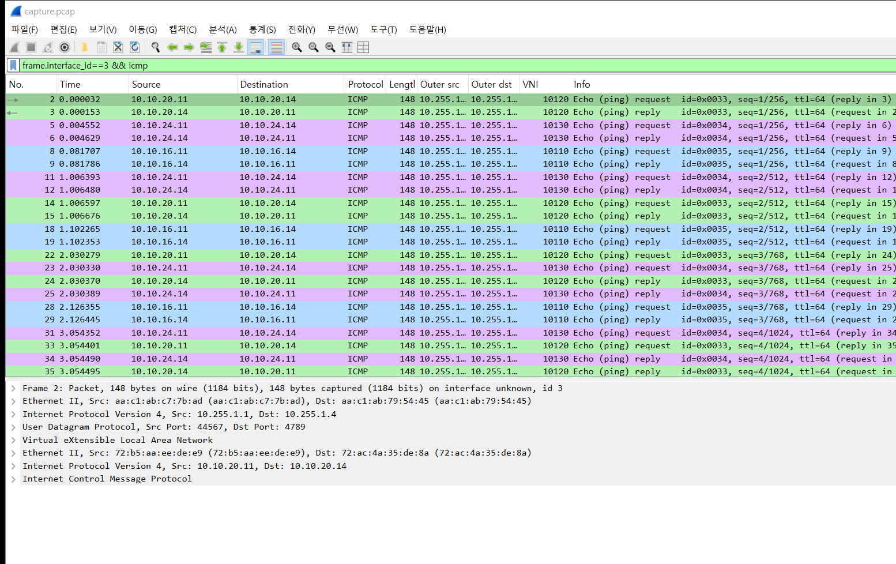
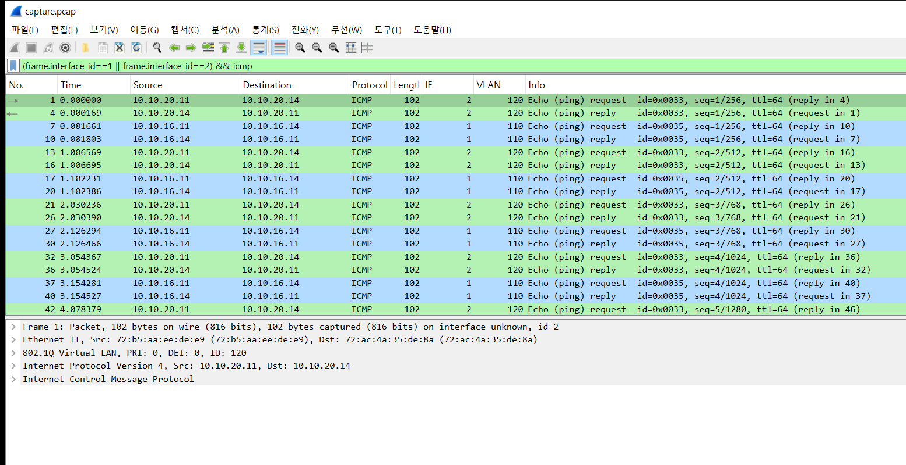
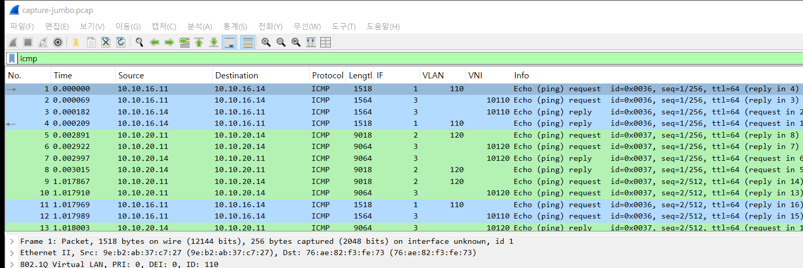
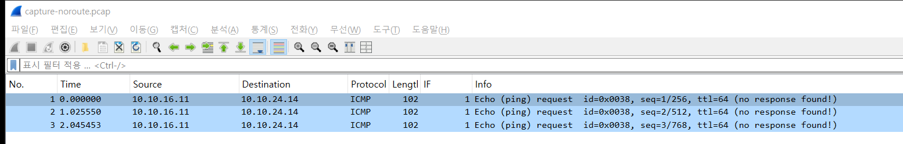
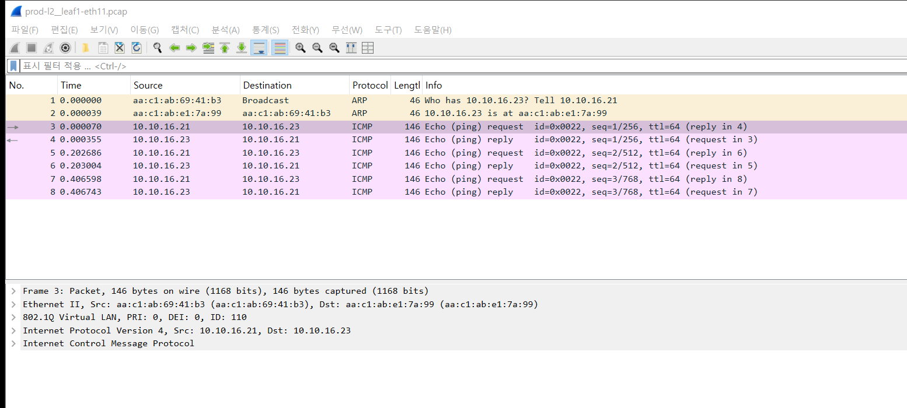
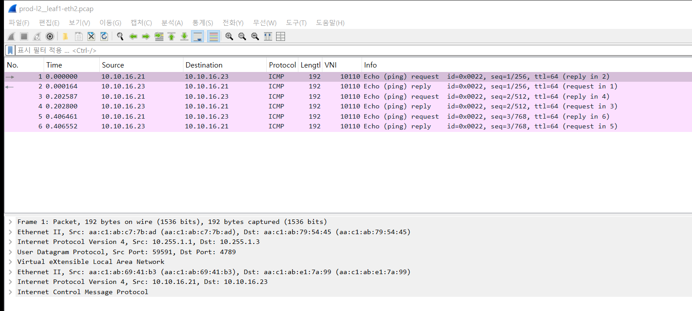
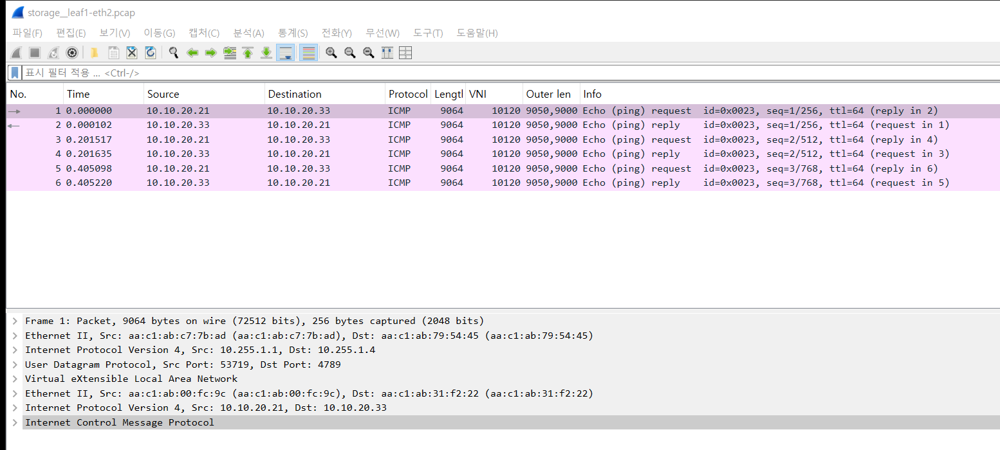
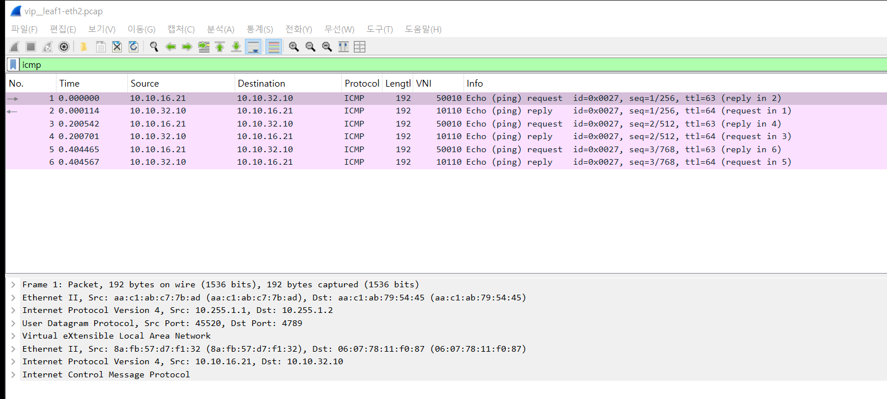
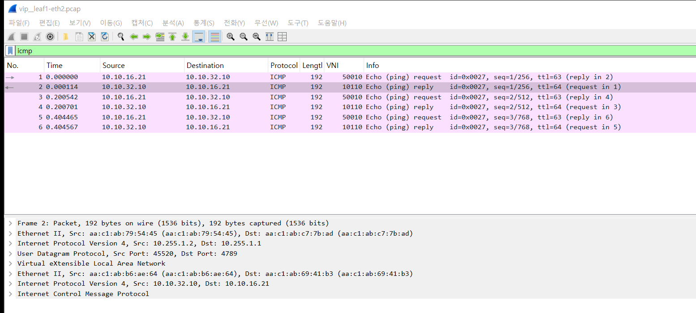
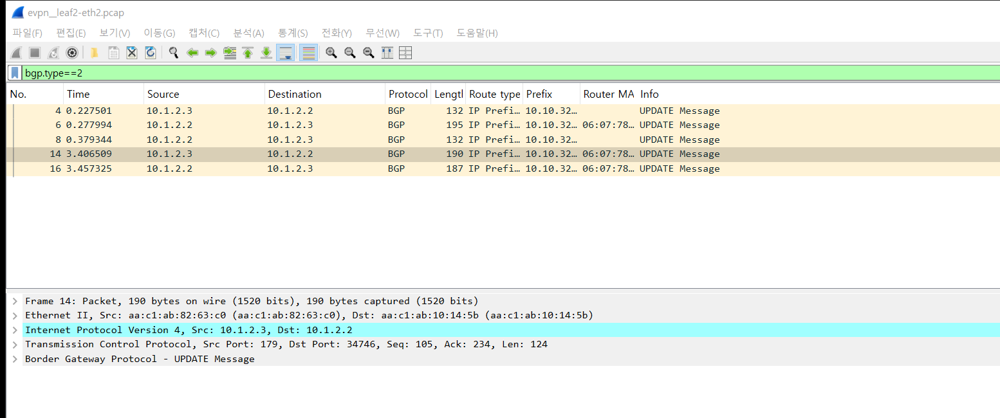

# 2026-10-22 — VRF 세 개가 한 선을 같이 쓰는 모습

> 이날 구경은 둘이다. 1부는 아래 VRF 세 개, 2부는 [k8s-ceph 경로별 패킷 모양과 흐름](#2부--k8s-ceph-경로별-패킷-모양과-흐름)(서버 포트·업링크 7흐름, Wireshark 화면 6장).

2026-10-22. k8s-ceph 랩 위에 `_tools/stage-vrf.sh`로 세운 무대에서 캡처했다.
VRF는 PROD·STORAGE·REPL 세 개다. leaf1 뒤 호스트가 leaf4 뒤 같은 VRF 호스트에게 ping을 보냈다.

```
 prod1 .11 ─VLAN 110─┐                            ┌─VLAN 110─ prod4 .14
 stor1 .11 ─VLAN 120─┤ leaf1 ══ spine1/spine2 ══ leaf4 ├─VLAN 120─ stor4 .14
 repl1 .11 ─VLAN 130─┘  eth15~17   (VXLAN)    eth15~17 └─VLAN 130─ repl4 .14
                  VTEP 10.255.1.1          VTEP 10.255.1.4
```

| VRF | VLAN | L2VNI | L3VNI | 대역 | MTU | 색 (그림) |
|---|---|---|---|---|---|---|
| PROD | 110 | 10110 | 50010 | 10.10.16.0/24 | 1500 | 파랑 |
| STORAGE | 120 | 10120 | 50020 | 10.10.20.0/24 | 9000 | 초록 |
| REPL | 130 | 10130 | 50030 | 10.10.24.0/24 | 9000 | 보라 |

캡처 지점은 leaf1의 업링크 두 개(eth1 → spine1, eth2 → spine2)와 호스트 쪽 포트(eth15·eth16)다.
pcap에는 인터페이스 이름이 없어서, Wireshark의 `frame.interface_id`(그림의 IF 열)로 지점을 구분한다. 번호표는 `raw/<주제>.points.txt`에 있다.

---

## 1. 한 통로, 세 엘리베이터

세 VRF에서 동시에 ping을 5번씩 보내고, leaf1 업링크를 봤다.



- 파랑·초록·보라 줄이 한 선에 번갈아 지나간다. 선은 하나인데 VRF는 셋이다
- 바깥 주소(Outer src/dst)는 세 VRF 모두 `10.255.1.1 → 10.255.1.4`로 같다. 아래 상세 창의 세 번째 줄이 그 바깥 IP다
- 구분하는 값은 VNI 열 하나뿐이다. 10110·10120·10130
- 상세 창을 위에서부터 읽으면 층이 보인다. 바깥 이더넷 → 바깥 IP(VTEP끼리) → UDP 4789 → VXLAN → 안쪽 이더넷 → 안쪽 IP(호스트끼리) → ICMP. 택배 상자 안에 원래 편지 봉투가 통째로 들어 있는 모양이다
- 이번에는 세 흐름이 모두 eth2(spine2)로 갔고 eth1에는 하나도 없었다. 스파인 두 개 중 어디로 갈지는 ECMP 해시가 흐름마다 고른다

> 이번 ping은 같은 대역끼리라(10.10.16.11 → 10.10.16.14) L2VNI(101x0)가 찍혔다.
> L3VNI(500x0)는 VRF 안에서 다른 대역으로 라우팅할 때 쓰인다. 5번의 경로 광고에서 볼 수 있다.

## 2. 입구는 따로

같은 캡처에서 호스트 쪽 포트(eth15·eth16)만 걸러 봤다.



- 리프에 들어오기 전에는 VRF마다 포트도 다르고(IF 1, 2) VLAN 태그도 다르다(110, 120)
- 상세 창에 `802.1Q Virtual LAN, ID: 120` 줄이 있다. 업링크(1번 그림)에는 이 줄이 없다

크기를 맞춰 보면 리프가 하는 일이 숫자로 보인다.

| 위치 | 크기 | 내용 |
|---|---|---|
| 호스트 포트 | 102 B | 원래 프레임 98 B + VLAN 태그 4 B |
| 업링크 | 148 B | 원래 프레임 98 B + VXLAN 포장 50 B (바깥 이더넷 14 + IP 20 + UDP 8 + VXLAN 8) |

리프는 VLAN 태그 4 B를 떼고, 그 자리 대신 VNI가 적힌 포장 50 B를 씌운다. 층마다 다른 번호표를 쓰는 셈이다. 건물 안에서는 출입증 색(VLAN)을 보고, 건물 밖 통로에서는 상자에 적힌 번호(VNI)를 본다.

## 3. 짐 크기 비교

PROD에서는 1500에 꽉 차는 ping(`-M do -s 1472`), STORAGE에서는 9000에 꽉 차는 ping(`-M do -s 8972`)을 보냈다. `-M do`는 쪼개지 말라는 뜻이다.



| VRF | 호스트 포트 | 업링크 |
|---|---|---|
| PROD | 1518 B | 1564 B |
| STORAGE | 9018 B | 9064 B |

- 업링크에서는 둘 다 정확히 46 B가 늘었다. 포장 50 B에서 떼어 낸 VLAN 태그 4 B를 뺀 값이다
- PROD에서 9000짜리를 보내 보면 선에 나가지도 않는다. 호스트가 먼저 거절한다

```
prod1$ ping -c1 -M do -s 8972 10.10.16.14
ping: local error: message too long, mtu=1500
```

- 같은 선(업링크)이 1564 B와 9064 B를 둘 다 실어 나른다. 업링크는 큰 쪽(9000 + 포장)에 맞춰 두고, 짐 규격은 VRF 입구에서 정한다

## 4. 버튼이 없는 층

PROD 호스트(prod1)에서 REPL 주소(10.10.24.14)로 ping을 3번 보냈다. 지점은 eth15(입구)와 업링크 두 개다.



- 세 줄 모두 IF 1(eth15, 입구)이다. 업링크(IF 0, 2)에는 하나도 찍히지 않았다
- 응답도 없다(`no response found!`)
- 리프의 PROD 경로표에 REPL 대역이 아예 없다 ([raw/tables.txt](raw/tables.txt))

```
leaf1# show ip route vrf PROD
C>* 10.10.16.0/24 is directly connected, br110
B>* 10.10.16.22/32 [20/0] via 10.255.1.2, br50010 onlink
B>* 10.10.16.23/32 [20/0] via 10.255.1.3, br50010 onlink
B>* 10.10.32.10/32 [20/0] via 10.255.1.2, br50010 onlink
   (발췌. 10.10.24.0/24는 어디에도 없다)
```

엘리베이터에 그 층 버튼이 없으니 아예 출발하지 않는다. 선에 아무것도 없다는 것 자체가 분리의 증거다.

## 5. VRF별 주소록 — Route Target

데이터 패킷이 VNI로 나뉜다면, 그 VNI를 어디로 보낼지 알려 주는 경로 광고는 Route Target(RT)으로 나뉜다.
leaf4에서 EVPN 경로를 다시 보내게 하고(`clear bgp l2vpn evpn * soft out`, 설정 변경 없음) leaf4 업링크에서 BGP를 캡처했다.

leaf4가 자기 VRF 대역을 알리는 Type-5(IP Prefix) 경로 세 개:

| 대역 | RD | L3VNI | RT | next-hop |
|---|---|---|---|---|
| 10.10.16.0/24 | 10.255.1.4:8 | 50010 | 65000:50010 | 10.255.1.4 |
| 10.10.20.0/24 | 10.255.1.4:9 | 50020 | 65000:50020 | 10.255.1.4 |
| 10.10.24.0/24 | 10.255.1.4:10 | 50030 | 65000:50030 | 10.255.1.4 |

- 대역 하나에 꼬리표가 세 개 붙는다. RD는 누가 낸 경로인지 구분하고, RT는 어느 VRF가 받아 갈지 정하고, VNI는 데이터를 실을 때 쓸 번호다
- 받는 리프는 RT를 보고 자기 VRF로 가져간다. leaf1의 PROD는 `65000:50010`만 가져가므로 REPL 대역이 PROD 경로표에 들어오지 않는다. 4번에서 버튼이 없던 이유가 여기 있다
- 원문은 [raw/vrf-rt.excerpt.txt](raw/vrf-rt.excerpt.txt). 맨 아래 확장 커뮤니티에 RT와 Router's MAC이 있다
- 호스트 MAC/IP를 알리는 Type-2 경로에는 RT가 두 개 붙어 있었다. L2 쪽 `65000:10110`과 FRR이 자동으로 만든 `65011:50010`(리프 AS:L3VNI)이다

---

## 쉽게 말하면

스파인 쪽 선은 엘리베이터 통로 하나이고, VRF는 그 통로를 같이 쓰는 엘리베이터 세 대다.
패킷 겉봉에 적힌 출발지·도착지(VTEP)는 셋이 똑같고, 다른 것은 VNI 번호 하나뿐이다.
리프는 입구의 VLAN 태그를 떼고 VNI 번호를 붙여 내보낸다. 버튼(경로)은 RT 꼬리표로 VRF마다 따로 나눠 준다. 그래서 다른 VRF로는 출발조차 하지 않는다.

## 다시 해 보기

```bash
bash packets/_tools/stage-vrf.sh up
```

```bash
bash packets/_tools/peek.sh vrf -t 8 leaf1:eth1 leaf1:eth2 leaf1:eth15 leaf1:eth16 -f "not tcp port 179 and not udp port 3784" -g "prod1 ping -c 5 10.10.16.14" -g "stor1 ping -c 5 10.10.20.14" -g "repl1 ping -c 5 10.10.24.14"
```

Wireshark에서 VNI별로 색을 칠하려면 [../_tools/wireshark-profile/colorfilters](../_tools/wireshark-profile/colorfilters)를 프로파일에 넣는다. 화면은 `../_tools/ws-shot.ps1`로 찍었다.

## 파일

| 파일 | 내용 |
|---|---|
| img/ | 그림 4장. 이름의 첫 점 앞이 출처 pcap (`vrf.uplink.png` ← `raw/vrf.pcap`) |
| raw/vrf.pcap | 1·2번. 세 VRF 동시 ping |
| raw/vrf-jumbo.pcap | 3번. 1500/9000 ping |
| raw/vrf-noroute.pcap | 4번. PROD → REPL |
| raw/vrf-rt.pcap | 5번. leaf4 → 스파인 EVPN UPDATE, 전체 길이 |
| raw/*.points.txt | pcap마다 IF 번호 → 지점 |
| raw/tables.txt | leaf1 VRF별 경로표, `show evpn vni`, Type-5 목록 |
| raw/vrf-rt.excerpt.txt | 5번의 UPDATE 하나 원문 |

---

## 2부 — k8s-ceph 경로별 패킷 모양과 흐름

> **한 줄** — 노드망(PROD), 스토리지망(STORAGE), 복제망(REPL)마다 패킷을 하나씩 흘려 보내고, 서버 포트와 리프 업링크에서 캡처해
> 같은 ping이 구간마다 어떤 헤더를 달고 지나가는지 나란히 놓았다.

```bash
# WSL root, 저장소 위치에서
k8s-ceph/up.sh                        # 랩이 안 떠 있으면
packets/_tools/k8s-flows.sh           # 흐름 7개 송신 + 캡처 + 해독문 → packets/<날짜>/raw/k8s-*
packets/_tools/k8s-flows.sh storage   # 흐름 하나만
```

pcap은 헤더만 보이도록 앞 256바이트만 저장했다. Wireshark로 열어도 되고, 함께 둔 해독문 `raw/k8s-<흐름>.decode.txt`만 읽어도 된다.
Wireshark는 UDP 4789를 VXLAN으로 바로 해독한다. 점보 패킷에 `[Packet size limited during capture]`가 붙는 건 256바이트만 저장해서다.
아래 화면은 모두 이 pcap을 Wireshark로 연 것이다(`../_tools/ws-shot.ps1`로 찍었다).
아래 수치는 모두 2026-10-22 캡처에서 그대로 옮겼다.

### 캡처 위치

```
            spine1                    spine2
              ╳ (이번 캡처에서는 0패킷)  │
   ┌──────────┴──────┬──────────────┬──┴───────────┐
 leaf1             leaf2          leaf3          leaf4
 eth1/eth2 ◀───── 업링크 = VXLAN 바깥 헤더가 보이는 곳 ─────▶
 eth11 eth12       eth11 eth13 eth14  eth11 eth13 eth14  eth13 eth14
   │     │           │     │    │       │     │    │       │    │
 wrk1 ───┘         wrk2  ceph1──┘     wrk3  ceph2──┘     ceph3──┘
 ◀── 서버 포트 = 802.1Q 태그가 붙은 원래 프레임이 보이는 곳 ──▶
```

한 흐름마다 네 곳에서 동시에 떴다. 출발 리프의 서버 포트 → 출발 리프 업링크 두 줄 → 도착 리프 업링크 두 줄 → 도착 리프의 서버 포트.
리프와 서버 컨테이너에는 tcpdump가 없어서 호스트(WSL)의 tcpdump를 `nsenter`로 노드 네트워크 안에 넣어 돌렸다.

### 한눈에

| # | 흐름 | 서버 포트에서 | 업링크에서 | VNI | 지나간 스파인 |
|---|---|---|---|---|---|
| 1 | PROD 같은 서브넷 wrk1 → wrk3 | VLAN 110, 146B | UDP 4789, 192B | 10110 (L2) | spine2 |
| 2 | STORAGE 점보 wrk1 → ceph3 | VLAN 120, 9018B | UDP 4789, **9064B** | 10120 (L2) | spine2 |
| 3 | REPL 복제 ceph3 → ceph1 | VLAN 130, 9018B | UDP 4789, 9064B | 10130 (L2) | spine2 |
| 4 | PROD 라우팅 wrk1 → VIP | VLAN 110, 146B | 가는 길 **50010 (L3)**, 오는 길 **10110 (L2)** | 비대칭 | spine2 |
| 5 | 막힌 길 wrk1 노드망 → Ceph public | VLAN 110, 102B | **0패킷** | 없음 | 없음 |
| 6 | 워커 BGP wrk2 ↔ leaf2 | VLAN 110 위 TCP 179 | (안 나감) | 없음 | 없음 |
| 7 | EVPN 경로 leaf2 → 스파인 | (없음) | TCP 179, MP_REACH | Type-5 | 둘 다 |

### 패킷 모양

같은 ICMP echo(데이터 100바이트)가 구간마다 이렇게 바뀐다. 흐름 1 기준.

```
서버 포트 (leaf1 eth11)                          146 B
┌──────────────┬──────────┬───────────┬──────────┬───────────┐
│ Ethernet 14  │ 802.1Q 4 │ IPv4 20   │ ICMP 8   │ data 100  │
│ wrk1 → wrk3  │ VLAN 110 │ .16.21 →  │ echo req │           │
│ (MAC)        │          │ .16.23    │          │           │
└──────────────┴──────────┴───────────┴──────────┴───────────┘
                     │ leaf1이 태그를 떼고, br110 → vx10110 로 넘긴다
                     ▼
업링크 (leaf1 eth2 → spine2)                                          192 B
┌──────────────┬───────────┬─────────┬──────────┬═════════════════════════════════════════┐
│ Ethernet 14  │ IPv4 20   │ UDP 8   │ VXLAN 8  ║ Ethernet 14 │ IPv4 20 │ ICMP 8 │ data  ║
│ leaf1→spine2 │ 10.255.1.1│ →4789   │ VNI      ║ wrk1 → wrk3 │ (그대로)│        │ 100   ║
│ (MAC)        │ →10.255.1.3│ src 해시 │ 10110   ║ (원래 MAC)  │ TTL 64  │        │       ║
└──────────────┴───────────┴─────────┴──────────┴═════════════════════════════════════════┘
  바깥 헤더 50 B (리프끼리의 주소)                  안쪽 = 서버가 보낸 프레임 (태그만 빠짐)
                     │ spine2는 바깥 IP만 보고 라우팅한다 (바깥 TTL 64 → 63)
                     ▼
서버 포트 (leaf3 eth11)                          146 B, 처음과 같은 모양
```

같은 ping을 Wireshark로 두 곳에서 본 화면이다. 위는 leaf1의 서버 포트(eth11), 아래는 leaf1의 업링크(eth2).





아래쪽 해독 창의 줄 수가 패킷 모양 그 자체다. 서버 포트에서는 Ethernet · 802.1Q · IPv4 · ICMP 네 겹,
업링크에서는 Ethernet · IPv4 · UDP · VXLAN 바깥 네 겹 아래에 Ethernet · IPv4 · ICMP 안쪽 세 겹이 들어 있다. 802.1Q 줄만 빠졌다.

여기서 읽을 것 셋.

- **VLAN 태그는 리프 안에서 VNI로 바뀐다.** 서버 포트에서는 `vlan 110`, 업링크에서는 `vni 10110`. 태그 4바이트가 빠지고 바깥 헤더 50바이트가 붙어 146 → 192바이트가 된다
- **안쪽 프레임은 손대지 않는다.** 안쪽 MAC은 wrk1·wrk3의 진짜 MAC이고 안쪽 TTL도 64 그대로다. 같은 서브넷이라 라우팅이 아니라 브리징이기 때문이다. 바뀌는 건 바깥 TTL뿐(64 → 63, spine2 한 홉)
- **바깥 UDP 출발 포트는 흐름마다 다르다** (흐름 1은 59591, 2는 53719, 3은 46293, 4는 45520). 안쪽 헤더를 해시해 정하는 값이라 스파인이 이 포트까지 보면 흐름이 갈라질 수 있다. 응답도 같은 포트를 썼다

### 흐름별로

#### 1. PROD 같은 서브넷 — ARP는 리프가 대신 답한다

이웃 표를 비운 뒤 보냈으니 wrk1은 먼저 ARP를 브로드캐스트한다.

```
17:08:35.027304  wrk1 → ff:ff:ff:ff:ff:ff  vlan 110  ARP who-has 10.10.16.23
17:08:35.027343  aa:c1:ab:e1:7a:99 → wrk1  vlan 110  ARP 10.10.16.23 is-at aa:c1:ab:e1:7a:99
```

답이 39마이크로초 만에 왔고, 업링크(leaf1 eth2)와 leaf3 쪽에는 ARP가 한 개도 없다. leaf1이 EVPN Type-2 경로로 이미 알고 있던
wrk3의 MAC/IP로 **대신 답했다**(`neigh_suppress on`). 답의 출발 MAC이 wrk3 것이라 wrk1은 리프가 답한 줄 모른다.
브로드캐스트가 패브릭 전체로 퍼지지 않는 이유가 이것이다. 그 다음 ICMP 6개(요청 3 + 응답 3)는 위 그림대로 지나갔다.

#### 2. STORAGE 점보 — 바깥은 9050바이트

```
leaf1 eth12  wrk1 → ceph3   802.1Q, length 9018: vlan 120, IPv4 length 9000, DF   10.10.20.21 > 10.10.20.33
leaf1 eth2   leaf1 → spine2 IPv4, length 9064: UDP length 9050  10.255.1.1 > 10.255.1.4.4789  vni 10120
                            └ 안쪽: length 9014, IPv4 length 9000, DF
```



서버가 보낸 IP 패킷은 9000바이트, DF가 켜져 있어 어디서도 쪼개지지 않는다. 업링크에서 바깥 IP 길이는 **9050바이트**다.
그래서 언더레이 MTU는 9000이면 모자라고 최소 9050이 필요하다. 이 랩의 링크는 9500(containerlab 기본)이라 통과했고,
운영 설계에서 업링크를 9216으로 잡는 이유도 같다. 9000짜리 업링크였다면 이 ping은 조용히 사라진다.

#### 3. REPL 복제망 — 모양은 STORAGE와 같고 VNI만 다르다

```
leaf4 eth14  ceph3 → ceph1  vlan 130, IPv4 length 9000
leaf4 eth2   10.255.1.4 > 10.255.1.2.4789  vni 10130, UDP length 9050
```

패킷 모양으로는 STORAGE와 구별이 안 된다. 다른 건 VLAN 130 / VNI 10130 숫자 하나다. 복제망이 다른 망과 섞이지 않는 근거는 모양이 아니라
이 숫자가 리프 안에서 어느 브리지와 VRF로 들어가느냐다. br130은 VRF REPL에만 붙어 있고 REPL에는 밖으로 나가는 경로가 없다.

#### 4. PROD 라우팅 — 가는 길은 L3VNI, 오는 길은 L2VNI

VIP 10.10.32.10은 서브넷이 다르니 wrk1은 게이트웨이(애니캐스트 MAC `00:00:5e:00:01:01`)로 보낸다.

```
가는 길
leaf1 eth11  wrk1 → 00:00:5e:00:01:01        vlan 110   TTL 64   10.10.16.21 > 10.10.32.10
leaf1 eth2   10.255.1.1 > 10.255.1.2  vni 50010
             └ 안쪽: 8a:fb:57:d7:f1:32 → 06:07:78:11:f0:87   TTL 63
                     (leaf1 라우터 MAC)    (leaf2 라우터 MAC)
leaf2 eth11  00:00:5e:00:01:01 → wrk2         vlan 110   TTL 62

오는 길
leaf2 eth2   10.255.1.2 > 10.255.1.1  vni 10110          ← L3VNI가 아니다
             └ 안쪽: wrk2 → wrk1 (서버 MAC 그대로)   TTL 64
```

leaf1 업링크 하나에서 요청과 응답의 VNI가 번갈아 50010, 10110으로 찍힌다.





가는 길은 교과서대로의 대칭형 IRB다. leaf1이 VRF PROD에서 라우팅하고(TTL 63), 안쪽 MAC을 리프 라우터 MAC으로 바꿔 L3VNI 50010에 태운다.
안쪽 목적지 MAC `06:07:78:11:f0:87`은 흐름 7에서 leaf2가 Type-5 경로에 붙여 광고한 Router MAC 확장 커뮤니티 값과 같다.
leaf2가 받아서 한 번 더 라우팅하니 wrk2에 닿을 때 TTL은 62다.

오는 길은 다르다. leaf2에도 같은 서브넷(br110, 10.10.16.0/24)이 있고 wrk1의 MAC/IP를 Type-2로 알고 있으니, 라우팅하지 않고
**같은 서브넷 안의 브리징으로** L2VNI 10110에 태운다. 안쪽 MAC이 서버 MAC 그대로고 TTL도 64다.
모든 리프에 모든 VLAN이 깔린 구성에서는 응답이 이렇게 L2로 돌아오는 게 정상이고, 그래서 방화벽처럼 양방향을 다 봐야 하는 장비를
이 경로에 끼우면 가는 길과 오는 길이 다르게 보인다.

ICMP 3개는 모두 wrk2(leaf2)로 갔다. leaf1에는 VIP 경로가 2갈래(leaf2·leaf3) 있지만 같은 흐름은 같은 해시값이라 한쪽으로만 간다.

#### 5. 막힌 길 — 리프에서 끝난다

```
leaf1 eth11  wrk1 → 00:00:5e:00:01:01  vlan 110   10.10.16.21 > 10.10.20.31  echo request ×2
leaf1 eth1, eth2                                   0패킷
```

wrk1이 노드망 NIC로 Ceph public을 찾으면 요청은 leaf1까지 오지만 업링크로 한 개도 나가지 않고, 응답이나 ICMP unreachable도 없다.
leaf1의 VRF PROD에는 10.10.20.0/24 경로가 없고(그 대역은 VRF STORAGE에만 있다) 조용히 버려진다.
워커가 Ceph에 닿는 길은 스토리지 NIC(eth2.120)로 STORAGE에 직접 들어가는 것 하나뿐이다.

#### 6. 워커 BGP — 서버가 리프에게 경로를 알린다

wrk2가 VIP를 철회했다가 다시 광고했다. leaf2 eth11(VLAN 110 위)에서 본 BGP UPDATE.

```
철회  Update length 28   Withdrawn routes: 10.10.32.10/32
광고  Update length 56   AS Path: 65200   Next Hop: 10.10.16.22   Updated routes: 10.10.32.10/32
```

Cilium/MetalLB가 하는 일이 이 두 메시지다. 파드가 떠 있는 노드가 자기 주소를 next-hop으로 VIP를 광고하고, 파드가 빠지면 철회한다.
리프는 prefix-list로 10.10.32.0/24와 Pod 대역만 받는다.

#### 7. EVPN 경로 — 리프가 스파인에게 그 경로를 다시 알린다

같은 순간 leaf2 업링크에서는 일반 IPv4 UPDATE가 아니라 EVPN UPDATE가 나간다. tcpdump는 EVPN NLRI를 해독하지 못해(`no AFI 25 / SAFI 70 decoder`)
16진수로만 찍는데, 풀면 이렇다.

```
MP_REACH_NLRI  AFI 25 (L2VPN) / SAFI 70 (EVPN)   Next Hop 10.255.1.2 (leaf2 VTEP)
  05                      Route Type 5 (IP Prefix)
  22                      길이 34
  0001 0aff0102 0008      RD 10.255.1.2:8
  00 × 10                 ESI 없음
  00000000                Ethernet Tag 0
  20  0a0a200a            10.10.32.10/32
  00000000                Gateway IP 없음
  00c35a                  Label = 50010 (L3VNI)
AS Path        65012 65200          (leaf2 → wrk2)
Ext Community  encapsulation VXLAN
               target 65000:50010   (VRF PROD로 import 하라)
               0x0603 06:07:78:11:f0:87   (Router MAC = 흐름 4의 안쪽 목적지 MAC)
```

Wireshark는 tcpdump와 달리 EVPN을 해독한다. Route type 5, Prefix 10.10.32.10, Router MAC 06:07:78:11:f0:87이 열로 바로 보인다.
14번이 leaf2(10.1.2.3)가 spine2로 다시 광고하는 UPDATE다. Router MAC이 비어 있는 4·8번은 철회다.
Label 칸은 MPLS 라벨로 해석해 `3125 (BOGUS)`처럼 이상하게 나오는데, VXLAN에서는 그 3바이트가 그대로 VNI 50010이다.



흐름 6에서 wrk2가 알린 VIP 하나가 leaf2에서 Type-5 경로로 바뀌어 스파인을 거쳐 모든 리프로 퍼진다.
leaf1은 이 경로의 Label(50010)과 Router MAC을 보고 흐름 4의 바깥 VNI와 안쪽 목적지 MAC을 정한다. 컨트롤플레인 한 줄이 데이터플레인 헤더 두 칸이 된다.

### 덤으로 보인 것

**모든 흐름이 spine2로만 지나갔다.** leaf1·leaf2·leaf4의 eth1(spine1 쪽)은 7개 흐름 내내 0패킷이다.
언더레이 경로는 두 스파인으로 ECMP(next-hop 2개)인데도 그렇다. 리눅스 VXLAN은 원격 VTEP마다 경로를 하나 잡아 두고(dst_cache) 계속 쓰기 때문에,
VTEP 쌍 하나는 늘 스파인 하나로 간다. 이번 랩에서는 그 쌍들이 우연히 모두 spine2를 골랐다.

이걸 보고 `test.sh`의 장애 시험을 고쳤다. 원래는 spine1 링크를 끊었는데, 복제 트래픽은 처음부터 spine2로 다니고 있었으니
200/200 수신은 아무것도 증명하지 못했다. 지금은 복제 트래픽이 실제로 지나는 스파인을 `ip route get`으로 찾아 그쪽을 끊는다.
고친 뒤 spine2의 leaf2·leaf4 링크를 끊어도 200/200 수신이었다(링크가 내려가면 커널이 next-hop을 바로 빼고 다른 스파인으로 옮긴다).

### 파일 (2부)

| 파일 | 내용 |
|---|---|
| `../_tools/k8s-flows.sh` | 흐름 7개 송신 + 캡처 + 해독문 |
| `raw/k8s-<흐름>__<노드>-<포트>.pcap` | 원본 캡처 (앞 256바이트) |
| `raw/k8s-<흐름>.decode.txt` | 캡처 지점별 해독문. 위 인용은 모두 여기서 왔다 |
| `img/k8s-*.png` | Wireshark 화면 6장 |
