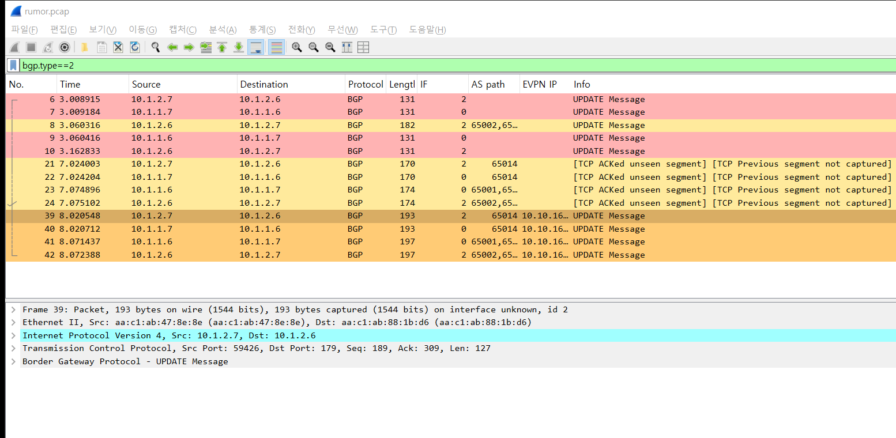
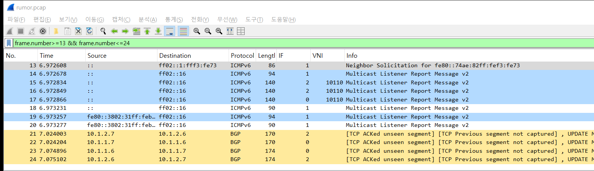
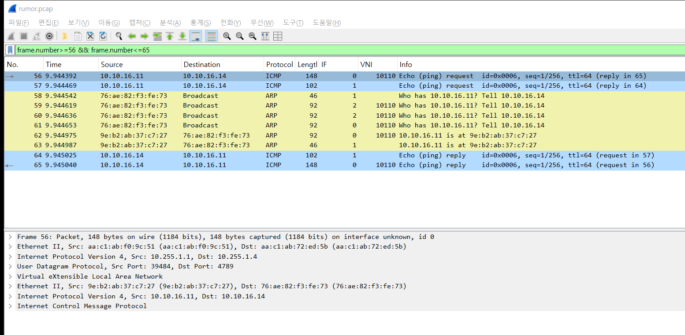

# 2026-10-23 — 소문이 퍼지는 순간 (EVPN Type-2)

호스트 하나가 사라졌다 돌아올 때, 리프가 그 사실을 BGP로 퍼뜨리는 순서를 패킷으로 따라간다.
무대는 어제와 같다(k8s-ceph 랩 + `_tools/stage-vrf.sh`). 주인공은 PROD VRF의 prod4다.

```
 prod1 10.10.16.11 ── leaf1 ══ spine1 / spine2 ══ leaf4 ── eth15 ── prod4 10.10.16.14
                     AS 65011   AS 65001 / 65002   AS 65014           MAC 76:ae:82:f3:fe:73
                     VTEP .1.1                     VTEP .1.4
```

## 무엇을 했나

15초 캡처 하나에 사건 세 개를 넣었다.

| 초 (스크립트 기준) | 사건 |
|---|---|
| 2 | prod4의 `eth1`을 내린다 |
| 6 | 다시 올리고, 1초 뒤 prod4가 게이트웨이(10.10.16.1)로 ping 1번 |
| 9 | prod1이 prod4로 ping 3번 |

카메라는 세 곳이다. pcap 하나에 합쳐 있고 `frame.interface_id`(그림의 IF 열)로 구분한다.

| IF | 지점 | 보이는 것 |
|---|---|---|
| 0 | leaf4:eth1 | spine1 쪽 업링크. BGP, VXLAN |
| 1 | leaf4:eth15 | prod4가 꽂힌 포트. VLAN 110 |
| 2 | leaf4:eth2 | spine2 쪽 업링크. BGP, VXLAN |

BGP keepalive와 ACK(100 B 미만), BFD는 필터로 뺐다. 그래서 Wireshark가 일부 UPDATE에 `TCP ACKed unseen segment`라고 투덜대는데, 뺀 ACK 때문일 뿐 UPDATE 내용은 온전하다.

```bash
bash packets/_tools/peek.sh rumor -t 15 -s 0 -n 100 leaf4:eth15 leaf4:eth1 leaf4:eth2 -f "not udp port 3784 and not (tcp port 179 and less 100)" -g "prod4 sleep 2; ip link set eth1 down; sleep 4; ip link set eth1 up; sleep 1; ping -c1 -W1 10.10.16.1" -g "prod1 sleep 9; ping -c 3 -W1 10.10.16.14"
```

---

## 한눈에 보는 순서



색: 빨강 = 철회, 연노랑 = MAC만 광고, 주황 = MAC + IP 광고. `bgp.type==2`로 UPDATE만 걸렀다.

| 프레임 | 시각 | 누가 → 누구 | 내용 |
|---|---|---|---|
| 6, 7 | 3.009 | leaf4 → 스파인 둘 | ① 철회: prod4 MAC 없어졌다 |
| 8 | 3.060 | spine2 → leaf4 | ①' 옛 경로 하나가 되돌아옴 (AS path 4개) |
| 9, 10 | 3.06~3.16 | 스파인 → leaf4 | ①'' 스파인도 철회 |
| 21, 22 | 7.024 | leaf4 → 스파인 둘 | ② 광고: MAC만 |
| 23, 24 | 7.075 | 스파인 → leaf4 | 스파인이 leaf4에게도 돌려준 사본 (AS path `65001 65014`) |
| 39, 40 | 8.021 | leaf4 → 스파인 둘 | ③ 광고: MAC + IP 10.10.16.14 |
| 41, 42 | 8.071 | 스파인 → leaf4 | 사본 |
| 56~ | 9.944 | leaf1 ↔ leaf4 | ④ 데이터가 VXLAN 10110으로 흐름 |

leaf4가 보낸 것은 스파인이 다른 리프에 그대로 돌리고, 그 사본이 다시 leaf4에게도 온다(AS path에 65014가 들어 있어 leaf4는 버린다). 그래서 같은 내용이 늘 두 쌍씩 보인다.

---

## ① 사라짐 — 철회

prod4 쪽 선을 내리면 leaf4의 eth15도 꺼지고, 브리지가 그 포트에서 배운 MAC을 지운다. FRR이 이걸 보고 BGP로 철회를 보낸다.

프레임 6을 펼치면 ([raw/rumor.excerpt.txt](raw/rumor.excerpt.txt) 첫 절):

```
Path Attribute - MP_UNREACH_NLRI
    Address family identifier (AFI): Layer-2 VPN (25)
    Subsequent address family identifier (SAFI): EVPN (70)
    Withdrawn Routes
        EVPN NLRI: MAC Advertisement Route
            Route Type: MAC Advertisement Route (2)
            Route Distinguisher: 10.255.1.4:2
            MAC Address: 76:ae:82:f3:fe:73
```

- `MP_UNREACH_NLRI`가 철회다. 광고는 `MP_REACH_NLRI`
- 지울 때는 무엇을 지우는지만 말한다. RD와 MAC만 있고 next-hop·RT 같은 꼬리표는 없다. 그래서 131 B로 가장 작다

### ①' 되돌아온 옛 경로 (프레임 8)

철회 50 ms 뒤 spine2가 leaf4에게 같은 MAC을 광고한다. AS path가 `65002 65011 65001 65014`다.

- 뒤에서부터 읽으면 leaf4(65014) → spine1(65001) → leaf1(65011) → spine2(65002)를 돌아온 경로다
- spine2는 leaf4가 직접 준 경로를 잃자, 다른 길로 들었던 예비 경로를 잠깐 최선으로 올린다. 그 예비 경로도 곧 철회가 따라와서(프레임 10) 사라진다
- 소문이 정정될 때 옛 소문이 한 바퀴 돌아오는 것과 같다. BGP에서는 path hunting이라고 부른다

## ② 돌아옴 — MAC만 먼저



선을 다시 올리면 prod4는 ARP보다 IPv6 패킷을 먼저 내보낸다(Neighbor Solicitation, Multicast Listener Report). 리눅스가 링크가 올라오면 자동으로 하는 일이다.

- leaf4는 이 패킷의 출발지 MAC으로 prod4를 다시 배운다
- 50 ms 뒤 프레임 21에서 광고가 나간다. 아직 IP는 모르니 **MAC만** 담겨 있다
- IPv6 멀티캐스트는 BUM이라 leaf4가 리프 세 곳에 복사해 VXLAN으로 보낸다(IF 0·2의 VNI 10110 줄)

## ③ IP까지 — 주소록 한 줄 완성

prod4가 게이트웨이로 ping을 하려면 먼저 ARP를 해야 한다(프레임 33, 34). 리프는 이 ARP로 MAC과 IP의 짝을 배운다. 50 ms 뒤 프레임 39에서 MAC + IP 광고가 나간다.

프레임 39를 펼친 주요 줄:

```
MP_REACH_NLRI
    Next hop: 10.255.1.4                         ← 이 MAC으로 보낼 상자는 leaf4 VTEP으로
    EVPN NLRI: MAC Advertisement Route
        Route Distinguisher: 10.255.1.4:2        ← 누가 낸 광고인지
        MAC Address: 76:ae:82:f3:fe:73           ← 누가
        IPv4 address: 10.10.16.14
        MPLS Label 1: 631                        ← L2VNI 10110
        MPLS Label 2: 3125                       ← L3VNI 50010
AS_PATH: 65014
EXTENDED_COMMUNITIES
    Encapsulation: VXLAN
    Route Target: 65000:10110                    ← 어느 L2 망(VLAN 110)이 가져갈지
    Route Target: 65000:50010                    ← 어느 VRF(PROD)가 가져갈지
    Router's MAC: 9e:e6:94:ae:f3:2a              ← 라우팅해서 보낼 때 안쪽 목적지 MAC
```

**Label 칸의 숫자가 VNI다.** EVPN은 MPLS용으로 먼저 만들어져서 VNI를 Label 자리(3바이트)에 넣는다. Wireshark는 그걸 MPLS 라벨(앞 20비트)로 읽어서 숫자가 이상하게 보인다.

| Wireshark 표시 | 16진 | 뒤에 4비트를 붙이면 | 실제 VNI |
|---|---|---|---|
| Label 1: 631 | 0x277 | 0x277E | 10110 |
| Label 2: 3125 | 0xC35 | 0xC35A | 50010 |

②의 MAC만 광고(프레임 21)에는 Label 1(631)과 RT `65000:10110` 하나뿐이다. IP를 알고 나서야 VRF 쪽 꼬리표(L3VNI, RT 50010, Router's MAC)가 붙는다.

## ④ 데이터가 다시 흐른다



prod1의 ping이 leaf1에서 VXLAN 10110에 실려 leaf4로 온다(프레임 56). 상세 창 순서대로 바깥 이더넷 → 바깥 IP 10.255.1.1 → 10.255.1.4 → UDP 4789 → VXLAN → 안쪽 이더넷 → 안쪽 IP 10.10.16.11 → 10.10.16.14다.

중간에 노란 ARP 묶음(프레임 58~63)이 끼어 있다.

- prod4는 선을 내렸다 올리면서 이웃 표를 잃었다. 그래서 답장을 보내기 전에 prod1의 MAC을 다시 묻는다
- 이 ARP는 leaf4가 대신 답하지 않고, 리프 세 곳(10.255.1.1·.2·.3)에 복사해 VXLAN으로 보냈다(59~61). 답은 leaf1에서 VXLAN으로 돌아왔다(62)
- 그 뒤 ping 2·3번째는 ARP 없이 바로 오간다

---

## 직접 뜯어보기

```bash
# UPDATE만 펼치기
tshark -r packets/2026-10-23/raw/rumor.pcap -Y "bgp.type==2" -V -O bgp

# AS path와 EVPN IP를 열로
tshark -r packets/2026-10-23/raw/rumor.pcap -Y "bgp.type==2" -T fields -E occurrence=a -E aggregator=" " -e frame.number -e frame.interface_id -e bgp.update.path_attribute.as_path_segment.as4 -e bgp.evpn.nlri.ip.addr
```

Wireshark 표시 필터 몇 개:

| 필터 | 보이는 것 |
|---|---|
| `bgp.update.path_attribute.type_code == 15` | 철회만 |
| `bgp.evpn.nlri.ip.addr` | MAC + IP 광고만 |
| `bgp.update.path_attribute.as_path_segment.as4 == 65011` | leaf1을 거쳐 온 경로 (프레임 8) |
| `frame.interface_id == 1` | prod4 포트에서 본 것만 |

색 규칙(철회 빨강, MAC 연노랑, MAC + IP 주황, ARP 노랑, VRF별 색)은 [../_tools/wireshark-profile/colorfilters](../_tools/wireshark-profile/colorfilters)에 있다.

## 쉽게 말하면

리프는 동네 반장이다. 집(prod4)이 비면 "그 집 비었어요"를 먼저 돌리고(①), 사람이 다시 들어오면 얼굴(MAC)만 보고 "누가 왔어요"를 돌린다(②). 이름(IP)까지 알게 되면 "10.10.16.14, 이 얼굴, leaf4 동네, PROD 반"이 적힌 주소록 한 줄을 다시 돌린다(③). 다른 반장들은 그 주소록을 보고 택배(VXLAN)를 바로 leaf4로 보낸다(④). 소문이 정정되는 동안 옛 소문이 한 바퀴 돌아오는 모습(①')도 덤으로 찍혔다.

## 파일

| 파일 | 내용 |
|---|---|
| raw/rumor.pcap | 캡처 전체, 86패킷, 전체 길이 |
| raw/rumor.points.txt | IF 번호 → 지점 |
| raw/rumor.excerpt.txt | 프레임 6·8·21·39(BGP)와 56(VXLAN)의 상세 트리 |
| img/rumor.bgp.png | Type-2 UPDATE만 |
| img/rumor.linkup.png | 링크 up 직후 (프레임 13~24) |
| img/rumor.data.png | 데이터와 ARP 복사 (프레임 56~65) |
