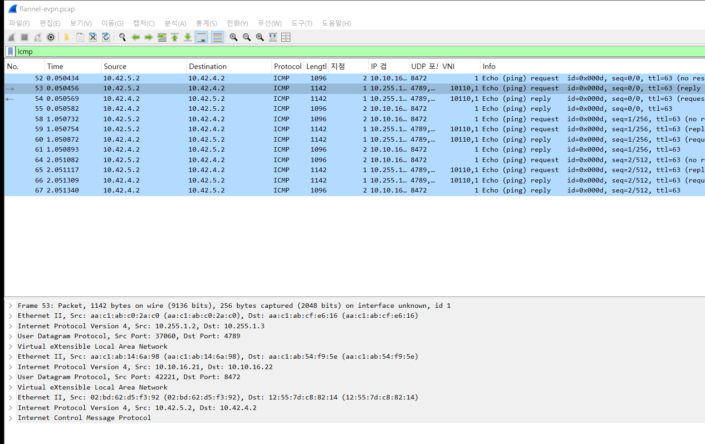
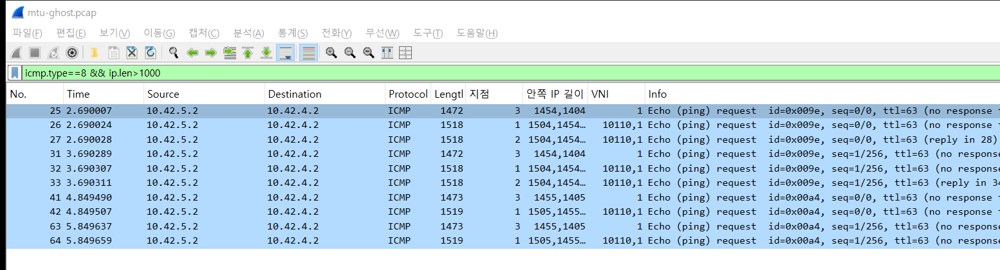

# 2026-10-28 — 상자 안의 상자 (Flannel VXLAN over EVPN VXLAN)

> **한 줄** — 랙을 건너는 Pod 핑 하나가 스파인에서는 VXLAN 두 겹에 싸여 있다. 패브릭 MTU를 1500으로 낮추면 작은 핑은 가고 큰 핑만 사라진다.

무대는 `../../k8s-rook` (스파인 2 / 리프 3, k3s 6대). Ceph는 띄우지 않고 k3s가 Ready 되는 데까지만 올렸다.

```
 pod1 10.42.5.2 ─ wrk1 10.10.16.21 ─ leaf2 ══ spine1/2 ══ leaf3 ─ wrk2 10.10.16.22 ─ pod2 10.42.4.2
 (rack2)          eth1.110 (VLAN 110)  VTEP .1.2            VTEP .1.3   (rack3)
 Flannel: flannel.1, UDP 8472, VNI 1, MTU 1450      리프: vx10110, UDP 4789, VNI 10110
```

| 겹 | 누가 싸나 | 주소 | 포트 / VNI |
|---|---|---|---|
| 바깥 | 리프 (EVPN) | 10.255.1.2 → 10.255.1.3 | 4789 / 10110 |
| 가운데 | 노드의 Flannel | 10.10.16.21 → 10.10.16.22 | 8472 / 1 |
| 안쪽 | Pod | 10.42.5.2 → 10.42.4.2 | ICMP |

---

## 장면 1 — 스파인에서 본 핑 하나 (세 겹)

`ping -s 1000` 3번. 지점 1 = spine2:eth2(leaf2 쪽), 2 = wrk1:eth1(노드 포트).



- 아래 칸에 Ethernet → IP → UDP → VXLAN이 **세 번** 반복된다. 4789 안에 8472, 그 안에 Pod ICMP
- 같은 요청이 노드 포트에서는 **1096B**(8472 한 겹 + VLAN 태그), 스파인에서는 **1142B**다
- spine1:eth2에서도 같이 떴지만 ICMP는 0개였다. 전부 spine2로 갔다

---

## 장면 2 — 패브릭 MTU 1500: 큰 핑만 사라진다

스파인 포트 6개(eth1~3 × 2)를 MTU 1500으로 낮추고 pod1 → pod2로 `-s 56 / 1376 / 1377`을 2번씩 보냈다.
지점 0 = leaf2:eth1, 1 = leaf2:eth2(spine2 쪽 업링크), 2 = spine2:eth2, 3 = wrk1:eth1.



| 핑 크기 | wrk1:eth1 | leaf2:eth2 (보냄) | spine2:eth2 (받음) | 결과 |
|---|---|---|---|---|
| `-s 56` | 152B | 198B | 198B | 2/2 |
| `-s 1376` | 1472B | **1518B** | 1518B | 2/2 |
| `-s 1377` | 1473B | **1519B** | **없음** | 0/2 |

- leaf2는 1519B를 내보냈는데 spine2 포트에는 찍히지 않는다. 1바이트 차이로 갈린다
- Pod 안에서 보면 Pod MTU(1450)보다 한참 작은 1405B 패킷이 사라진 것이다
- 끝나고 9500으로 되돌리니 `-s 1377`도 통과했다

---

## 장면 3 — 경계 찾기 (이분 탐색, 캡처 없음)

같은 조건에서 `ping -c 1 -s N`으로 경계를 좁혔다.

| 패브릭 MTU | 통과 | 실패 |
|---|---|---|
| 9500 (원래) | 56 · 1390 · 1391 · 1422 모두 | 없음 |
| 1500 | `-s 1376`까지 | `-s 1377`부터 |

---

## 쉽게 말하면

관리실(Flannel)이 편지를 상자에 넣고, 택배 지점(리프)이 그 상자를 또 큰 상자에 넣는다. 허브(스파인)는 맨 바깥 송장만 보고 넘긴다.
상자 크기 제한(MTU)을 줄이면 얇은 편지는 그대로 가고, 두꺼운 편지만 중간에서 말없이 사라진다.

## 파일

| 파일 | 내용 |
|---|---|
| `raw/flannel-evpn.pcap` | 10초, `ping -s 1000` 3번. spine1:eth2 · spine2:eth2 · wrk1:eth1. 130개 |
| `raw/mtu-ghost.pcap` | 15초, 스파인 MTU 1500 상태. leaf2:eth1 · eth2 · spine2:eth2 · wrk1:eth1. 157개 |
| `img/flannel-evpn.png` · `mtu-ghost.png` | 장면 1·2 화면 |

<details><summary>찍을 때 알아둔 것</summary>

- Wireshark는 8472를 VXLAN으로 모른다. `-d udp.port==8472,vxlan`(화면에서는 Decode As)을 줘야 안쪽이 펼쳐진다
- 스파인 MTU를 낮추면 노드 사이 k8s API(TLS 1564B)도 막혀 `kubectl exec`가 멈출 수 있다. 핑은 wrk1 안에서 `crictl exec`로 쐈다
- `peek.sh -g`에 `$(...)`를 넣으면 WSL 호스트에서 먼저 풀린다. 노드 안에 스크립트(`/tmp/p.sh`)를 두고 `-g "wrk1 sh /tmp/p.sh"`로 불렀다
- 지점 번호는 pcap의 interface_id다. `raw/*.points.txt`에 대응표가 있다
</details>
